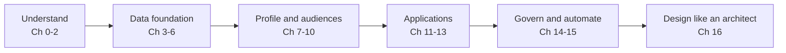

# Adobe Experience Platform (AEP): a hand-held guide

A step-by-step guide to understand Adobe Experience Platform and **contribute quickly on a real AEP project**. It starts in plain language, then goes chapter by chapter to architect-level detail, with diagrams, working code, a hands-on lab, and links to the official Adobe documentation and videos.

## Start here

- **New to AEP, joining a project this week?** Read [Chapter 0](docs/00-what-is-aep.md) (30 min), then [Chapter 1: Fast start on an AEP project](docs/01-fast-start-on-a-project.md). Keep the [cheat sheets](cheat-sheets.md) open in meetings.
- **Need depth on one topic?** Jump to that chapter; each one stands on its own.
- **Want hands-on practice?** Do the [lab](labs/README.md) in a development sandbox.

## How each chapter is written

**In plain words → why it matters on a project → diagram → how it works → step by step in the UI → code / API example → common mistakes → architect tips → official docs and videos → check yourself**

## Learning path

## Chapters

| # | Chapter | Level |
| --- | --- | --- |
| 0 | [What AEP is, in plain words](docs/00-what-is-aep.md) | Basic |
| 1 | [Fast start on an AEP project](docs/01-fast-start-on-a-project.md) | Basic |
| 2 | [Platform architecture](docs/02-platform-architecture.md) | Basic → Intermediate |
| 3 | [XDM data modelling](docs/03-xdm-data-modeling.md) | Basic → Advanced |
| 4 | [Identity Service](docs/04-identity-service.md) | Intermediate |
| 5 | [Data ingestion](docs/05-data-ingestion.md) | Intermediate |
| 6 | [Data collection: Web SDK, Mobile SDK, datastreams, Tags](docs/06-data-collection.md) | Intermediate |
| 7 | [Real-Time Customer Profile](docs/07-real-time-customer-profile.md) | Intermediate → Advanced |
| 8 | [Audiences and segmentation](docs/08-audiences-segmentation.md) | Intermediate → Advanced |
| 9 | [Query Service and Data Distiller](docs/09-query-service-data-distiller.md) | Intermediate → Advanced |
| 10 | [Destinations and activation](docs/10-destinations-activation.md) | Intermediate |
| 11 | [Real-Time CDP in depth](docs/11-real-time-cdp.md) | Advanced |
| 12 | [Adobe Journey Optimizer](docs/12-journey-optimizer.md) | Advanced |
| 13 | [Customer Journey Analytics](docs/13-customer-journey-analytics.md) | Advanced |
| 14 | [Data governance, privacy and security](docs/14-governance-privacy-security.md) | Advanced |
| 15 | [APIs, automation and DevOps](docs/15-apis-automation-devops.md) | Advanced |
| 16 | [Architect playbook and AI](docs/16-architect-playbook-ai.md) | Expert |

Also: [Cheat sheets](cheat-sheets.md) · [Glossary](glossary.md) · [All references and videos](references.md) · [Hands-on lab](labs/README.md)

## Code in this repository

| Folder | What it contains |
| --- | --- |
| [`code/api`](code/api) | Python scripts: get a token, call the Schema Registry, ingest data, look up a profile, work with audiences |
| [`code/xdm-schemas`](code/xdm-schemas) | Example field groups, schemas and identity descriptors (JSON) |
| [`code/web-sdk`](code/web-sdk) | Web SDK (alloy.js) snippets for websites |
| [`code/query-service`](code/query-service) | SQL for Query Service and Data Distiller |
| [`code/segmentation`](code/segmentation) | Audience definitions (PQL) and API payloads |
| [`code/journey-optimizer`](code/journey-optimizer) | Event payloads and custom action examples |

All code uses placeholders such as `<YOUR_TENANT_ID>`. Credentials are read from environment variables and are never committed. Set-up steps: [`code/api/README.md`](code/api/README.md).

> Limits ("guardrails") quoted in this guide are Adobe's documented defaults at the time of writing; your licence can differ, and Adobe updates them. Each chapter links to the live page.

## Progress

| Batch | Chapters | Status |
| --- | --- | --- |
| 1 | README, Ch 0-3, cheat sheets, auth and schema code | Done |
| 2 | Ch 4-6, identity, ingestion and Web SDK code | Done |
| 3 | Ch 7-10 | Planned |
| 4 | Ch 11-14 | Planned |
| 5 | Ch 15-16, lab, glossary, references | Planned |
