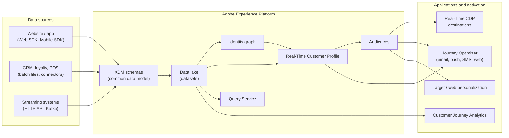

# Chapter 0: What AEP is, in plain words

**Goal of this chapter:** after 30 minutes you can explain AEP to a colleague, name its main parts, and know which Adobe application does what.

---

## 1. In plain words

Adobe Experience Platform (AEP) is a **cloud data platform for customer data**. It does five things:

1. **Collects** customer data from everywhere: websites, mobile apps, CRM, e-commerce, call centre, loyalty, offline stores.
2. **Standardizes** that data into one common format called **XDM** (Experience Data Model), so "email" means the same thing in every source.
3. **Joins** the data about the same person across sources (the **identity graph**): the cookie on the website, the email in the CRM and the loyalty number become one person.
4. **Builds a live profile** of each customer (the **Real-Time Customer Profile**) and groups customers into **audiences** ("gold members who browsed shoes in the last 7 days").
5. **Activates** that knowledge: sends audiences to ad platforms, email tools and websites, triggers journeys, personalizes pages, and powers analytics.

A simple analogy: if AEM is the system that **manages and delivers content**, AEP is the system that **knows the customer**. Together, AEM delivers the right content and AEP decides who should get it.

## 2. Why it matters on a project

Almost every AEP project answers the same business question: *"How do we use what we know about each customer to give a better, more relevant experience, in real time, across channels, while respecting consent and privacy?"*

Typical project goals you will hear:

| Business goal | What AEP does |
| --- | --- |
| "One view of the customer" | Identity graph + Real-Time Customer Profile |
| "Stop wasting ad spend on existing customers" | Audiences sent to Google, Meta, The Trade Desk to suppress or target |
| "Abandoned-cart emails within minutes" | Streaming data + streaming audience + Journey Optimizer |
| "Personalize the home page for known visitors" | Edge segmentation + Web SDK + Target or AJO |
| "Understand the full journey, online and offline" | Customer Journey Analytics on AEP datasets |
| "Be GDPR/CCPA compliant" | Consent data, data usage labels, Privacy Service |

## 3. The big picture

Read it left to right: data comes in, is shaped by XDM schemas, lands in datasets, identities are stitched, profiles are built, audiences are evaluated, and applications use them.

## 4. Platform vs applications (this confuses everyone at first)

**AEP is the platform** (the foundation). Customers usually buy **applications** that run on it, and the licence for the application includes the AEP capabilities it needs.

| Application | What it is for | Who uses it |
| --- | --- | --- |
| **Real-Time CDP** (Customer Data Platform) | Build profiles and audiences, send them to destinations (ads, email, CRM) | Marketing ops, data teams |
| **Journey Optimizer (AJO)** | Orchestrate journeys and campaigns: email, push, SMS, in-app, web, code-based experiences; offer decisioning | CRM and lifecycle marketing |
| **Customer Journey Analytics (CJA)** | Analyse any AEP data (online + offline) in Analysis Workspace | Analysts |
| **Adobe Target** (integrates) | A/B tests and personalization on web/app; can use AEP audiences | Optimization teams |
| **Mix Modeler, Product Analytics, GenStudio** (newer) | Marketing mix modelling, product usage analytics, content generation | Specialist teams |

Real-Time CDP comes in editions: **B2C**, **B2B** (accounts and opportunities) and **B2P** (both), and in packages such as **Prime** and **Ultimate**. The edition decides which features and limits you have, so always ask which one the client bought.

## 5. The ten words you must know on day one

| Term | Plain meaning |
| --- | --- |
| **Sandbox** | An isolated copy of the platform (like dev/stage/prod). Production and development sandboxes exist. |
| **XDM** | Adobe's standard data model. Everything in AEP is described with XDM. |
| **Schema** | The shape of a data set, built from a class + field groups. |
| **Class** | The base type of a schema: **Individual Profile** (who someone is) or **ExperienceEvent** (something that happened, with a timestamp). |
| **Field group** | A reusable block of fields added to a schema (e.g. "Personal Contact Details"). |
| **Dataset** | A table in the data lake that stores data for one schema. |
| **Identity / namespace** | An ID (email, CRM ID, ECID cookie) and its type. |
| **Profile** | The merged, real-time view of one person. |
| **Audience** (formerly "segment") | A group of profiles that match rules. |
| **Destination** | Where you send audiences or data (Google, Meta, Salesforce, S3...). |

The full list is in the [glossary](../glossary.md).

## 6. Two kinds of data, one rule to remember

- **Record data** (Profile class): attributes that describe a person *now*: name, email, loyalty tier. A new value **overwrites** the old one.
- **Time-series data** (ExperienceEvent class): things that *happened*: page view, purchase, email open. Each event is **appended** and kept with its timestamp.

If you remember only one modelling rule: *"Is it a fact about who they are, or something they did at a point in time?"* The answer picks the class.

## 7. How data moves: batch, streaming, edge

| Path | Speed | Example |
| --- | --- | --- |
| **Batch** | Minutes to hours | Nightly CRM file from S3 |
| **Streaming** | Seconds | Web SDK events, HTTP API, Kafka |
| **Edge** | Milliseconds, on Adobe's edge network | Personalize the page during the same visit |

The speed you need decides the design: an abandoned-cart email needs streaming; a monthly loyalty report can use batch.

## 8. Common misunderstandings

| Misunderstanding | Reality |
| --- | --- |
| "AEP is a data warehouse" | It has a data lake and SQL, but it is built for real-time profiles and activation, not as the company's warehouse. Federated Audience Composition can use your warehouse without copying data. |
| "Profile = all data in the data lake" | Only datasets you **enable for Profile** feed the profile store. Many datasets stay in the lake only. |
| "Segments run instantly" | Depends on the evaluation method: batch (daily), streaming (minutes), edge (milliseconds). |
| "We can send any data anywhere" | Data usage labels, consent and policies can block activation by design. |
| "It's just Adobe Analytics with profiles" | Analytics is a separate product; CJA is the AEP-based analytics app. |

## 9. Official docs and videos

- [Experience Platform documentation home](https://experienceleague.adobe.com/en/docs/experience-platform)
- [How Experience Platform and applications work together](https://experienceleague.adobe.com/en/docs/experience-platform/landing/getting-started/apps-overview)
- [Getting started for data architects and data engineers (hands-on track)](https://experienceleague.adobe.com/en/docs/platform-learn/getting-started-for-data-architects-and-data-engineers/overview)
- [Video playlist: Get started with Real-Time CDP for marketers](https://experienceleague.adobe.com/en/playlists/real-time-customer-data-platform-get-started-for-marketers)

## 10. Check yourself

1. In one sentence, what is the difference between AEM and AEP?
2. A customer's loyalty tier changes from Silver to Gold. Is that record or time-series data?
3. Name the three ways data can move into or through AEP, and one use case for each.
4. A client says "we bought Real-Time CDP". What is your first follow-up question?
5. Why might a dataset in the data lake not appear in profiles?

Answers

1. AEM manages and delivers content; AEP collects and unifies customer data to decide who gets what.
2. Record data (Profile class): it describes who they are now.
3. Batch (nightly CRM import), streaming (web events for abandoned cart), edge (same-visit personalization).
4. Which edition and package (B2C/B2B/B2P, Prime/Ultimate), and which add-ons; it decides features and limits.
5. It isn't enabled for Profile (or its schema isn't enabled for Profile, or it has no identity).

---

Next: [Chapter 1: Fast start on an AEP project](01-fast-start-on-a-project.md)
