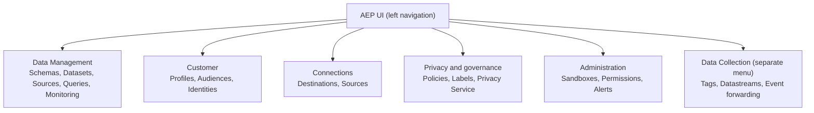
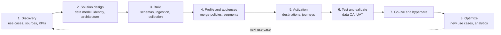

# Chapter 1: Fast start on an AEP project

**Goal of this chapter:** in your first week you can (1) get the right access, (2) understand an existing AEP set-up in a few hours, (3) follow the conversations in project meetings, and (4) take your first tickets with confidence.

---

## 1. Day 1: get access (ask for these on the first morning)

| What | Ask whom | Why |
| --- | --- | --- |
| Adobe ID added to the client's **Admin Console** organization | Client's Adobe admin | Without it you see nothing |
| **Product profiles** for Experience Platform / Real-Time CDP / Journey Optimizer / CJA | Client's Adobe admin | Each app has its own profiles |
| **Roles in AEP Permissions** (which sandboxes, which features: schemas, datasets, audiences, destinations, query...) | AEP product admin | AEP uses role-based and attribute-based access control |
| Access to **development sandbox(es)** first; production read-only later | AEP product admin | Never learn in production |
| **Developer Console** project with an OAuth Server-to-Server credential (if you will call APIs) | AEP developer admin | Needed for scripts and Postman |
| Data collection access (**Tags** properties, **datastreams**) | Tags admin | Web/app data collection |
| Project documents: solution design, data dictionary, use-case list, architecture diagram | Project lead | Saves days of guessing |
| Source system contacts (CRM, e-commerce, data engineering) | Project lead | Data questions always come up |

Docs: [Access control overview](https://experienceleague.adobe.com/en/docs/experience-platform/access-control/home) · [Sandboxes overview](https://experienceleague.adobe.com/en/docs/experience-platform/sandbox/home)

## 2. Find your way around the AEP UI

Log in at `experience.adobe.com`, choose the organization, then **Experience Platform**. Check the **sandbox switcher** at the top right before you touch anything.



Menu names move slightly between releases; the areas stay the same.

## 3. Understand an existing implementation in about 3 hours

Do this in a development sandbox (or production with read-only rights). Write notes as you go: they become your personal "system map".

### Step 1: Schemas (30 min)

1. Open **Schemas**, filter by **Class**. Count Profile schemas vs ExperienceEvent schemas.
2. Open each schema with the **Profile** toggle on. Note: the primary identity field, other identity fields, custom field groups (they sit under `_<tenantId>`).
3. Note relationships (lookup schemas, B2B account relationships).

*Questions to answer:* What does the client model as a person? What events do they track? Which ID is primary?

### Step 2: Datasets (20 min)

1. Open **Datasets**. For each dataset: schema, **Profile enabled?**, last batch, record count, failed batches.
2. Note which datasets are lake-only (often raw or analytics-only data).

### Step 3: Sources and data collection (30 min)

1. **Sources**: which connectors (S3, Azure, Snowflake, Salesforce, Marketo...), their schedules, and dataflow health.
2. **Data Collection → Datastreams**: which datastreams exist, which services are switched on (AEP, Target, Analytics, AJO, Event Forwarding).
3. **Tags**: the web property, the Web SDK extension configuration, and the rules that send events.

### Step 4: Identities and profiles (30 min)

1. **Identities**: list of namespaces (standard + custom). Check identity settings (unique namespaces and priority) if graph linking rules are in use.
2. **Profiles → Overview**: total profile count, profiles by namespace, merge policies (which one is default?).
3. Look up a test profile by email or CRM ID: view attributes, events, audience membership, identity graph.

### Step 5: Audiences and destinations (30 min)

1. **Audiences**: count, evaluation method (batch / streaming / edge), origin (Segmentation Service, custom upload, Audience Composition, Federated).
2. **Destinations**: which platforms, what is mapped, activation schedule, any failures.

### Step 6: Query the data (30 min)

Open **Queries → Create query** and run:

```sql
-- What datasets (tables) exist?
SHOW TABLES;

-- How many rows in a dataset?
SELECT COUNT(*) FROM <dataset_table_name>;

-- What kinds of web events arrive, last 7 days?
SELECT eventType, COUNT(*) AS events
FROM <web_events_table>
WHERE timestamp >= date_sub(current_date, 7)
GROUP BY eventType
ORDER BY events DESC;
```

The table name is shown on each dataset's page. More SQL in [Chapter 9](09-query-service-data-distiller.md) and [`code/query-service`](../code/query-service).

### Step 7: Applications (as relevant)

- **Journey Optimizer**: live journeys, their entry events or audiences, channels configured.
- **CJA**: connections (which datasets), data views, key dashboards.

At the end, draw the client's flow on one page using the diagram in [Chapter 0](00-what-is-aep.md#3-the-big-picture) as a template.

## 4. How an AEP project runs



Most AEP programs are **use-case driven**: each release delivers a small set of business use cases end to end (data in → profile → audience → activation → measurement), rather than "load all data first".

## 5. Who does what

| Role | Owns | You'll work with them when |
| --- | --- | --- |
| Solution / enterprise architect | Overall design, use-case mapping, integrations | Any design decision |
| Data architect | XDM model, identity strategy, data dictionary | Schema or identity changes |
| Data engineer | Sources, data prep, batch/streaming pipelines, Query Service jobs | Loading or fixing data |
| Implementation / tagging engineer | Web SDK, Tags, datastreams, mobile SDK | Website and app tracking |
| Marketing technologist / CDP specialist | Audiences, destinations, merge policies | Audience build and activation |
| AJO developer / campaign specialist | Journeys, messages, offers | Journey use cases |
| Analyst | CJA connections, data views, reports | Measurement |
| Privacy / legal / DPO | Consent, labels, policies, data subject requests | Any personal data or new destination |
| Client product owner | Priorities, acceptance | Every sprint |

## 6. Typical deliverables (you will be asked to produce or update these)

| Deliverable | What it contains |
| --- | --- |
| Use-case catalogue | Each use case: goal, data needed, audience logic, activation channel, KPI, priority |
| Data dictionary / XDM mapping | Source field → XDM field, type, identity, labels, transformations |
| Schema design document | Classes, field groups, relationships, Profile enablement, rationale |
| Identity strategy | Namespaces, primary identity per dataset, graph linking rules, known risks |
| Data flow / architecture diagram | Sources, ingestion method, frequency, datasets, consumers |
| Audience inventory | Name, rules (PQL), evaluation type, merge policy, destinations |
| Destination mapping | Identity and attribute mapping per destination, schedule, consent policy |
| Consent and governance matrix | Labels per field, policies, consent field usage |
| Test plan | Data validation queries, profile checks, audience counts, activation checks |

## 7. Your first tickets and how to approach them

| Ticket | How to approach | Chapter |
| --- | --- | --- |
| "Add field X from CRM to the profile" | Check the data dictionary → add field to the custom field group (non-breaking change) → update the source mapping (Data Prep) → backfill if needed → verify on a test profile | 3, 5 |
| "Build audience: customers who purchased in 30 days and are gold tier" | Check fields exist in Profile → write in Segment Builder → choose evaluation type → validate counts with a query → review merge policy | 8, 9 |
| "Send audience to Meta / Google" | Check destination exists and consent policy → map identities (hashed email) → set schedule → monitor activation | 10, 14 |
| "Website events are missing" | Check Tags rule fires → Web SDK debugging (Adobe Experience Platform Debugger, Assurance) → datastream mapping → dataset failed batches | 6 |
| "Profile count looks wrong / merged profiles" | Inspect identity graph for a sample → check shared IDs, graph linking rules → check merge policy | 4, 7 |
| "Batch failed" | Open dataset → failed batch → error file → fix mapping or data types → re-ingest | 5 |

## 8. Questions that make you look experienced in meetings

- "Which **sandbox** are we talking about, and what's the promotion path to production?"
- "What is the **primary identity** for this dataset, and is the dataset **enabled for Profile**?"
- "Is this audience **batch, streaming or edge**, and does the use case's timing need that?"
- "Which **merge policy** does this audience and destination use?"
- "What **consent** and **data usage labels** apply to these fields before we activate them?"
- "What's the **volume**: rows per day, events per second? Are we within the guardrails?"
- "How will we **measure** the use case after go-live?"

## 9. Your first-week plan

| Day | Do |
| --- | --- |
| 1 | Access, read the project docs, Chapters 0-1 of this guide |
| 2 | Explore the implementation (section 3), draw the system map |
| 3 | Chapters 2-4 (architecture, XDM, identity); compare with the client's set-up |
| 4 | Chapters 5-8 skimming; shadow a teammate on a ticket |
| 5 | Take a small ticket (new field, simple audience); write down open questions; review with the lead |

## 10. Common beginner mistakes

| Mistake | Avoid it by |
| --- | --- |
| Changing a schema in production directly | Change in dev sandbox, promote with sandbox tooling (packages) |
| Enabling a schema for Profile too early | Profile-enabled schemas can only have non-breaking changes; design first |
| Using email as the only identity everywhere | Plan identities with the data architect; consider hashed email, CRM ID, ECID |
| Building audiences on lake-only data | Only Profile-enabled data is available to the Segment Builder |
| Ignoring failed batches | Check dataset monitoring after every change |
| Activating data without labels/consent review | Always involve the privacy owner for new destinations |

## 11. Official docs and videos

- [Getting started for data architects and data engineers](https://experienceleague.adobe.com/en/docs/platform-learn/getting-started-for-data-architects-and-data-engineers/overview)
- [Access control overview](https://experienceleague.adobe.com/en/docs/experience-platform/access-control/home)
- [Sandboxes overview](https://experienceleague.adobe.com/en/docs/experience-platform/sandbox/home)
- [Query Service overview](https://experienceleague.adobe.com/en/docs/experience-platform/query/home)
- [Real-Time Customer Profile UI guide](https://experienceleague.adobe.com/en/docs/experience-platform/profile/ui/user-guide)
- [Video playlist: Get started with Real-Time CDP for marketers](https://experienceleague.adobe.com/en/playlists/real-time-customer-data-platform-get-started-for-marketers)

## 12. Check yourself

1. You're told "the audience count dropped by 40% overnight". List the first three places you look.
2. Why is a development sandbox mandatory for your first changes?
3. What's the difference between a Profile-enabled dataset and a lake-only dataset?
4. Name four deliverables on a typical AEP project.

<details>
<summary>Answers</summary>

1. Failed batches on the datasets feeding the audience; identity graph/merge policy changes; changes to the audience definition or its source fields (and evaluation job status).
2. Schema and identity changes can be hard or impossible to undo once data is ingested and Profile-enabled; production holds real customer data.
3. Profile-enabled datasets feed the Real-Time Customer Profile (usable in audiences and activation); lake-only datasets are only available to Query Service, CJA and other lake consumers.
4. Use-case catalogue, data dictionary/XDM mapping, identity strategy, audience inventory (also: destination mapping, consent matrix, test plan).
</details>

---

Previous: [Chapter 0](00-what-is-aep.md) · Next: [Chapter 2: Platform architecture](02-platform-architecture.md)
