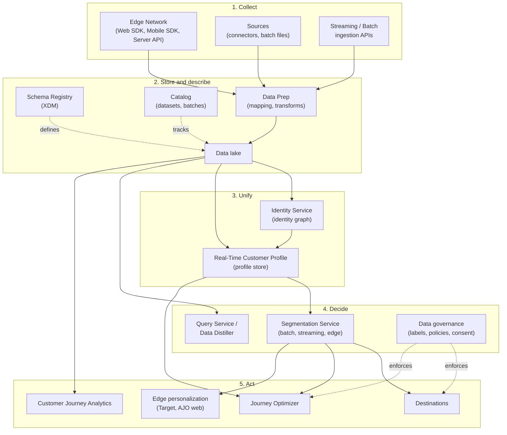
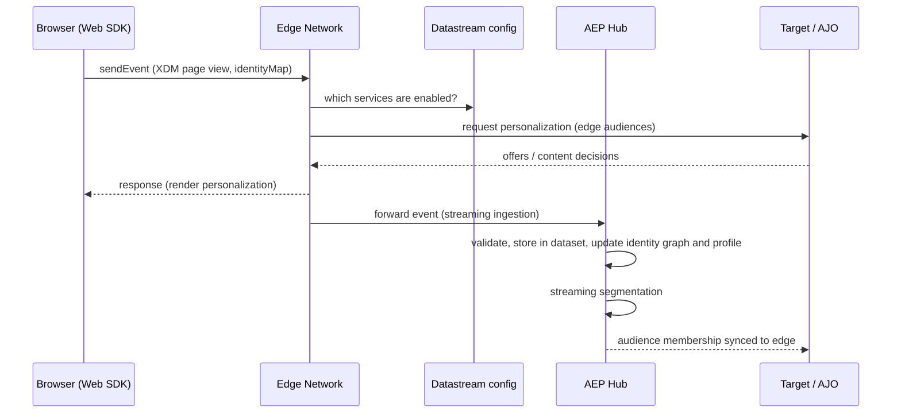

# Chapter 2: Platform architecture

**Goal of this chapter:** you can draw AEP's architecture on a whiteboard, explain how data flows from collection to activation, and know which service is responsible for what (and which API to call).

---

## 1. In plain words

AEP is a set of cooperating cloud services that share one data model (XDM) and one catalog of datasets. Think of it in five layers:

1. **Collect**: get data in (Edge Network for web/app events, Sources for systems, APIs).
2. **Store**: keep everything in the **data lake** as datasets.
3. **Unify**: stitch identities (**Identity Service**) and build profiles (**Real-Time Customer Profile**).
4. **Decide**: evaluate **audiences** (Segmentation Service), run **queries** (Query Service / Data Distiller), apply **governance**.
5. **Act**: send to **destinations**, run **journeys**, **analyse** in CJA, **personalize** on the edge.

## 2. Architecture diagram



## 3. The services, one by one

| Service | Responsibility | API base path (on `https://platform.adobe.io`) |
| --- | --- | --- |
| **Schema Registry** | Classes, field groups, data types, schemas, descriptors | `/data/foundation/schemaregistry` |
| **Catalog** | Datasets, batches, metadata | `/data/foundation/catalog` |
| **Batch Ingestion** | Upload files into datasets | `/data/foundation/import` |
| **Streaming Ingestion** | Send records/events in real time over HTTP | inlet URLs from the streaming connection (`dcs.adobedc.net`) |
| **Flow Service** | Sources and destinations connections and dataflows | `/data/foundation/flowservice` |
| **Data Prep** | Field mapping and transformation functions during ingestion | `/data/foundation/conversion` |
| **Identity Service** | Namespaces, identity graphs | `/data/core/identity` |
| **Real-Time Customer Profile** | Profile lookup, merge policies, computed attributes | `/data/core/ups` |
| **Segmentation Service** | Audience definitions and evaluation jobs | `/data/core/ups/segment/...` and audiences endpoints |
| **Query Service** | SQL over the data lake, scheduled queries | `/data/foundation/query` |
| **Sandbox Management** | Create/reset sandboxes, sandbox tooling packages | `/data/foundation/sandbox-management` |
| **Policy Service** | Data usage labels and policies | `/data/foundation/dulepolicy` |
| **Privacy Service** | Access/delete requests (GDPR, CCPA) | separate Privacy Service API |

Exact paths and versions are in the [API reference](https://developer.adobe.com/experience-platform-apis/). Every call needs the same four headers (Chapter 15 and [`code/api`](../code/api)):

```text
Authorization: Bearer <access_token>
x-api-key: <client_id>
x-gw-ims-org-id: <org_id>@AdobeOrg
x-sandbox-name: <sandbox_name>
```

## 4. Hub and edge

AEP has two "places" where work happens:

- **Hub**: the central platform in the client's Adobe data region. Data lake, full profiles, batch and streaming segmentation, destinations.
- **Edge**: Adobe's globally distributed **Edge Network**. It receives Web SDK/Mobile SDK calls close to the visitor, routes them via **datastreams** to the right services, and can hold **edge profiles** and evaluate **edge audiences** in milliseconds for same-page personalization.



The browser gets its personalization in the same call, while the event continues to the hub for the profile, audiences and analytics.

## 5. Sandboxes

| Type | Use | Notes |
| --- | --- | --- |
| **Production** | Live data and activation | Default production sandbox is usually named `prod`; additional production sandboxes possible |
| **Development** | Build and test | Can be reset; doesn't count for production activation |

- Each sandbox has its own schemas, datasets, profiles, audiences, destinations. Nothing is shared automatically.
- Move configuration between sandboxes with **sandbox tooling** (export a package of schemas, datasets, journeys, audiences... and import it into another sandbox). This is your "promotion" mechanism.
- The number of sandboxes depends on the licence.

Docs: [Sandboxes overview](https://experienceleague.adobe.com/en/docs/experience-platform/sandbox/home) · [Sandbox tooling](https://experienceleague.adobe.com/en/docs/experience-platform/sandbox/ui/sandbox-tooling)

## 6. Data lake vs profile store

This is the most important architectural distinction in AEP.

| | Data lake | Profile store |
| --- | --- | --- |
| What | All ingested datasets, full history | Merged, indexed, real-time view per person |
| Fed by | Every dataset | Only datasets **enabled for Profile** |
| Used by | Query Service, Data Distiller, CJA, ML | Audiences, destinations, AJO, edge personalization, profile lookup |
| Speed | Analytical (seconds to minutes per query) | Low-latency lookups (milliseconds) |
| Cost driver | Storage, query compute | Licensed profile count and "profile richness" (data size per profile) |

**Design rule:** load into the lake what you need for analytics and history; enable for Profile only what you need for real-time audiences, personalization and activation. This keeps profiles small, fast and within licence.

## 7. Guardrails (limits) you must know

Adobe publishes default limits ("guardrails"). Some are **hard** (the system enforces them) and some are **performance** guardrails (exceed them and things slow down or degrade). Examples from Adobe's Profile and ingestion guardrail pages:

| Guardrail | Default | Type |
| --- | --- | --- |
| ExperienceEvents per profile used in segmentation | 5,000 most recent | Performance |
| Size of one ExperienceEvent | 10 KB | Hard |
| Datasets using the ExperienceEvent class (Profile) | 20 recommended max | Performance |
| Profile + ExperienceEvent batches per day, per sandbox | 90 | Performance |
| Array items in an ExperienceEvent | 10 or fewer recommended | Performance |

Identity graphs, audiences, destinations and AJO have their own guardrail pages. Always check the live pages and the client's licence before designing:

- [Profile and segmentation guardrails](https://experienceleague.adobe.com/en/docs/experience-platform/profile/guardrails)
- [Data ingestion guardrails](https://experienceleague.adobe.com/en/docs/experience-platform/ingestion/guardrails)
- [Identity Service guardrails](https://experienceleague.adobe.com/en/docs/experience-platform/identity/guardrails)
- [Journey Optimizer guardrails](https://experienceleague.adobe.com/en/docs/journey-optimizer/using/get-started/essentials/guardrails)
- [Licence entitlement best practices](https://experienceleague.adobe.com/en/docs/experience-platform/landing/license/data-management-best-practices)

## 8. Security and access in the architecture

- **Organization (IMS org)** → **Admin Console** product profiles → **AEP Permissions** roles.
- **Role-based access control**: roles grant features (manage schemas, view profiles, activate destinations) per sandbox.
- **Attribute-based access control**: restrict access to specific fields/audiences by labels (e.g. only the privacy team sees sensitive fields).
- Encryption at rest and in transit by default; **customer-managed keys** as an option (Chapter 14).
- Data residency: each organization is provisioned in an Adobe region; check it early for regulated clients.

## 9. Architect tips

- Start every design from the **use case**, then walk it through the five layers: collect → store → unify → decide → act. If one layer is unclear, the use case isn't ready.
- Decide **latency per use case** (batch / streaming / edge) before choosing sources and audience types.
- Keep **profile-enabled data minimal**; push analytics-only data to the lake.
- Treat sandboxes like environments in software delivery: dev → (stage) → prod, promoted with sandbox tooling.
- Put **guardrails** in your design document with the expected volumes next to them.

## 10. Common mistakes

| Mistake | Consequence |
| --- | --- |
| Profile-enabling every dataset | Licence overage, slow segmentation, noisy profiles |
| Assuming the edge sees all profile data | Edge profiles hold only what's projected for edge use |
| Not planning sandboxes for promotion | Manual rebuilds in production, drift |
| Ignoring the data region | Compliance issues for regulated data |

## 11. Official docs and videos

- [Experience Platform documentation home](https://experienceleague.adobe.com/en/docs/experience-platform)
- [How Platform and applications work together](https://experienceleague.adobe.com/en/docs/experience-platform/landing/getting-started/apps-overview)
- [Getting started with Platform APIs](https://experienceleague.adobe.com/en/docs/experience-platform/landing/platform-apis/api-guide)
- [Platform API reference](https://developer.adobe.com/experience-platform-apis/)
- [Profile and segmentation guardrails](https://experienceleague.adobe.com/en/docs/experience-platform/profile/guardrails)

## 12. Check yourself

1. Name the five layers and one service in each.
2. What's the difference between the hub and the edge?
3. A team wants 3 years of clickstream for analysis and 30 days for audiences. How do you design the datasets?
4. Which four headers does every Platform API call need?

<details>
<summary>Answers</summary>

1. Collect (Edge Network / Sources), Store (data lake / Catalog / Schema Registry), Unify (Identity Service / Profile), Decide (Segmentation / Query Service / governance), Act (Destinations / AJO / CJA).
2. The hub is the central platform (lake, full profile, batch/streaming segmentation, destinations); the edge is Adobe's global network that handles web/app calls and same-page personalization with edge audiences.
3. Keep the full history in a lake dataset for CJA/Query Service; feed Profile only with what audiences need (and use experience event expiration / data retention so profile events age out after ~30 days).
4. `Authorization` (Bearer token), `x-api-key`, `x-gw-ims-org-id`, `x-sandbox-name`.
</details>

---

Previous: [Chapter 1](01-fast-start-on-a-project.md) · Next: [Chapter 3: XDM data modelling](03-xdm-data-modeling.md)
