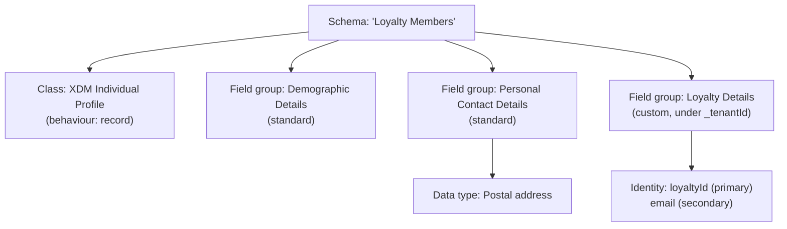
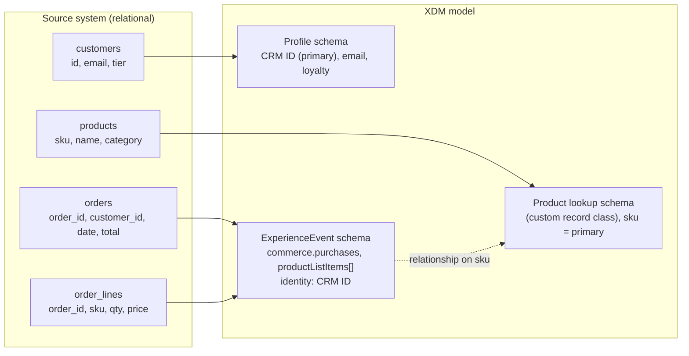

# Chapter 3: XDM data modelling

**Goal of this chapter:** you can read any XDM schema, design a data model for a use case, build it in the UI or by API, and avoid the modelling mistakes that are hard to undo.

---

## 1. In plain words

**XDM (Experience Data Model)** is Adobe's open standard for describing customer experience data. Every piece of data in AEP must fit an XDM **schema**, so every service (identity, profile, audiences, analytics) can understand it without custom code.

A schema is built like Lego:

- a **class**: the base type (what kind of thing is this?)
- plus **field groups**: reusable blocks of fields
- that may use **data types**: reusable structures (e.g. an address)
- with **identity fields** marked, so AEP can link records to people



## 2. Why it matters on a project

The data model is the **foundation** of everything else. A good model makes audiences easy, identities clean and activation fast. A bad model is expensive: once a schema is enabled for Profile and holds data, you can only make **additive** changes. Fixing a wrong design often means a new schema, a new dataset and re-ingesting history.

## 3. Classes and behaviours

| Class | Behaviour | Use for | Required fields |
| --- | --- | --- | --- |
| **XDM Individual Profile** | Record | Attributes of a person: name, email, preferences, loyalty tier, consents | Identity |
| **XDM ExperienceEvent** | Time-series | Things that happened: page views, purchases, email opens, call-centre contacts | `_id`, `timestamp` |
| **XDM Business Account / Opportunity / Campaign...** (B2B) | Record | Accounts, opportunities, B2B entities (Real-Time CDP B2B edition) | Identity |
| **Custom classes** | Record or time-series | Lookup data such as product catalogue, store list | Depends |

Rule of thumb: **who they are → Profile; what they did → ExperienceEvent; reference data → a lookup schema linked by a relationship**.

## 4. Field groups and data types

- **Standard field groups** (provided by Adobe): e.g. *Demographic Details*, *Personal Contact Details*, *Consents and Preferences*, *Identity Map*, *Web Details*, *Commerce Details*, *Adobe Analytics ExperienceEvent Template*, *AEP Web SDK ExperienceEvent*. Use them whenever possible: applications such as AJO, CJA and destinations recognize standard fields.
- **Custom field groups**: your own fields. They are placed under your organization's **tenant namespace**, an object called `_<tenantId>` (e.g. `_acmeretail`), so they never clash with Adobe's fields.
- **Data types**: reusable object structures (e.g. "Loyalty Program"), usable in several field groups. Prefer data types when the same structure appears in several schemas.

Example of how a custom field looks in data:

```json
{
  "person": { "name": { "firstName": "Asha", "lastName": "Rao" } },
  "personalEmail": { "address": "asha@example.com" },
  "_acmeretail": {
    "loyalty": { "loyaltyId": "L-100234", "tier": "gold", "points": 4200, "joinDate": "2021-03-14" }
  }
}
```

## 5. Identities in the schema

AEP needs to know **which fields identify a person**, so it can build the identity graph and the profile. Two ways to mark identities:

| Method | How | When |
| --- | --- | --- |
| **Identity field** in the schema | Mark a field (e.g. `loyaltyId`) as identity with a namespace; one can be **primary** | Batch/record data from systems: CRM, loyalty |
| **identityMap** | A map in the data itself: `{ "ECID": [...], "Email": [...] }`, with `primary: true` on one | Web/Mobile SDK events where identities vary per call |

```json
"identityMap": {
  "ECID":  [ { "id": "12345678901234567890123456789012345678", "authenticatedState": "ambiguous", "primary": true } ],
  "Email": [ { "id": "asha@example.com", "authenticatedState": "authenticated", "primary": false } ]
}
```

Every Profile-enabled schema needs a **primary identity** (field or identityMap). Chapter 4 covers namespaces and the identity graph in depth.

## 6. Relationships

- **Lookup relationship**: link an event field (e.g. `productSku`) to a record schema (Product catalogue) so audiences can use product attributes ("bought any product in category 'shoes'"). Uses a *reference identity descriptor* and a *relationship descriptor*.
- **B2B relationships**: Person ↔ Account ↔ Opportunity in Real-Time CDP B2B.

## 7. Schema evolution: what you can and cannot change

Once a schema is **enabled for Profile** (or used by datasets with data), changes must be **non-destructive**:

| Allowed | Not allowed |
| --- | --- |
| Add new fields or field groups | Remove or rename fields |
| Add a new optional field to a custom field group | Change a field's data type |
| Add enum values (with care) | Make an optional field required |
| Add descriptors (e.g. a new identity) | Change or remove the primary identity once data exists |
| | Disable Profile for a schema with Profile data (requires clean-up) |

That's why you **design first, build in a development sandbox, then promote**.

## 8. The union schema

When several schemas of the same class are enabled for Profile, AEP combines them into a **union schema** per class. Audiences and profile views read from the union. Implication: the same field in two schemas must mean the same thing, which is another reason to reuse field groups instead of copying fields.

## 9. Designing a model: step by step

1. **List the use cases** and the data each needs (attributes, events, timing).
2. **Inventory sources**: tables, fields, keys, volumes, update frequency.
3. **Draw the entities** (ERD): Person, Transaction, Product, Store...
4. **Decide the class** for each entity: person attributes → Profile; transactions/interactions → ExperienceEvent; reference data → lookup (custom record class).
5. **Denormalize** for events: an order event carries its line items (`productListItems`) instead of joining tables at query time.
6. **Map to standard field groups first**, then create custom field groups only for what's missing.
7. **Choose identities**: primary identity per dataset, secondary identities, namespaces.
8. **Decide Profile enablement** per schema (only what audiences/activation need).
9. **Add data usage labels** to sensitive fields (Chapter 14).
10. **Review** with data owners, then build in dev.



## 10. Build it in the UI (step by step)

1. **Schemas → Create schema** → choose *Individual Profile* (or *Experience Event*).
2. Name it clearly: `<Brand> - <Entity> - <Source>`, e.g. `Acme - Loyalty Members - CRM`.
3. **Add field groups**: search the standard ones first.
4. **Create a custom field group** for missing fields; add fields under the `_<tenantId>` object; set types, enums, descriptions.
5. Select the identity field → tick **Identity** → choose namespace → tick **Primary** if it's the primary identity.
6. Add data usage labels if required.
7. Save. Turn on **Profile** only when the design is final (it's a one-way step for practical purposes).
8. **Datasets → Create dataset from schema**; enable for Profile when ready.

Docs: [Create a schema in the Schema Editor](https://experienceleague.adobe.com/en/docs/experience-platform/xdm/tutorials/create-schema-ui)

## 11. Build it by API (code in this repo)

The script [`code/api/create_loyalty_schema.py`](../code/api/create_loyalty_schema.py) does the whole flow:

1. Get your tenant ID.
2. Create a custom identity namespace (`loyaltyId`) if missing.
3. Create a custom field group from [`code/xdm-schemas/fieldgroup-loyalty.json`](../code/xdm-schemas/fieldgroup-loyalty.json).
4. Create a Profile schema with standard + custom field groups.
5. Add an identity descriptor (loyaltyId primary).
6. Enable the schema for Profile (adds the `union` tag).
7. Create a dataset enabled for Profile and Identity.

Core calls (shortened):

```http
POST /data/foundation/schemaregistry/tenant/fieldgroups
Content-Type: application/json
{ "title": "Acme Loyalty Details",
  "meta:intendedToExtend": ["https://ns.adobe.com/xdm/context/profile"],
  "definitions": { "loyalty": { "properties": { "_<TENANT_ID>": { "type": "object", "properties": { "loyalty": { ... } } } } } },
  "allOf": [ { "$ref": "#/definitions/loyalty" } ] }

POST /data/foundation/schemaregistry/tenant/schemas
{ "title": "Acme - Loyalty Members - CRM", "type": "object",
  "allOf": [ { "$ref": "https://ns.adobe.com/xdm/context/profile" },
             { "$ref": "https://ns.adobe.com/xdm/context/profile-personal-details" },
             { "$ref": "<custom field group $id>" } ] }

POST /data/foundation/schemaregistry/tenant/descriptors
{ "@type": "xdm:descriptorIdentity", "xdm:sourceSchema": "<schema $id>", "xdm:sourceVersion": 1,
  "xdm:sourceProperty": "/_<TENANT_ID>/loyalty/loyaltyId", "xdm:namespace": "loyaltyId",
  "xdm:property": "xdm:code", "xdm:isPrimary": true }

PATCH /data/foundation/schemaregistry/tenant/schemas/<schema meta:altId>
[ { "op": "add", "path": "/meta:immutableTags", "value": ["union"] } ]
```

Docs: [Create a schema using the Schema Registry API](https://experienceleague.adobe.com/en/docs/experience-platform/xdm/tutorials/create-schema-api) · [Field groups endpoint](https://experienceleague.adobe.com/en/docs/experience-platform/xdm/api/field-groups) · [Schemas endpoint](https://experienceleague.adobe.com/en/docs/experience-platform/xdm/api/schemas)

## 12. Common mistakes

| Mistake | Better |
| --- | --- |
| One giant schema for everything | One schema per entity/source with shared field groups |
| Copying the source table 1:1 into a custom field group | Map to standard fields first (AJO, CJA and destinations understand them) |
| Putting events in a Profile schema as arrays ("lastPurchases[]") | Model events as ExperienceEvents |
| Using an e-mail as primary identity in every dataset | Choose a stable person ID (CRM/loyalty) for system data; ECID for anonymous web |
| Free-text values for things you segment on | Enums or controlled values (`tier`: bronze/silver/gold) |
| Enabling Profile before review | Review, test in dev with sample data, then enable |
| Very wide events with large arrays | Respect the 10 KB event size and keep arrays small |

## 13. Architect tips

- Keep a **data dictionary** as the single source of truth (source field → XDM path → type → identity → label → use case).
- Use **naming conventions** for schemas, field groups, datasets and namespaces across sandboxes.
- Create **one custom field group per domain** (loyalty, preferences, commerce extensions), not per source.
- For B2C, the usual core is: one CRM Profile schema, one web/app ExperienceEvent schema (Web SDK field group), one offline transaction ExperienceEvent schema, optional product lookup.
- Plan **retention**: experience event expiration and dataset retention limit Profile size.

## 14. Official docs and videos

- [XDM system overview](https://experienceleague.adobe.com/en/docs/experience-platform/xdm/home)
- [Model data in schemas (hands-on lesson)](https://experienceleague.adobe.com/en/docs/platform-learn/getting-started-for-data-architects-and-data-engineers/model-data-in-schemas)
- [Video playlist: Model your customer experience data with XDM](https://experienceleague.adobe.com/en/playlists/experience-platform-model-your-customer-experience-data-with-xdm)
- [Video: Convert your data model to XDM](https://experienceleague.adobe.com/en/docs/platform-learn/tutorials/schemas/convert-your-data-model-to-xdm)
- [Create a schema with the Schema Editor](https://experienceleague.adobe.com/en/docs/experience-platform/xdm/tutorials/create-schema-ui)
- [Create a schema with the API](https://experienceleague.adobe.com/en/docs/experience-platform/xdm/tutorials/create-schema-api)
- [Define a relationship between two schemas (API)](https://experienceleague.adobe.com/en/docs/experience-platform/xdm/tutorials/relationship-api)
- [Schema Registry API appendix](https://experienceleague.adobe.com/en/docs/experience-platform/xdm/api/appendix)

## 15. Check yourself

1. A "newsletter opt-in date" field: Profile or ExperienceEvent? And "newsletter email opened"?
2. Why do custom fields sit under `_<tenantId>`?
3. Name three changes you cannot make to a Profile-enabled schema.
4. When would you use identityMap rather than an identity field?
5. Design: an airline wants flight bookings, loyalty tier and airport reference data. Which classes?

<details>
<summary>Answers</summary>

1. Opt-in (current state) → Profile (consents/preferences); email opened → ExperienceEvent.
2. To avoid collisions with Adobe standard fields and other organizations' fields.
3. Remove/rename a field, change a field type, make an optional field required (also: change primary identity once data exists).
4. When identities vary per event, e.g. Web/Mobile SDK sending ECID and sometimes a login ID.
5. Loyalty tier → Individual Profile; bookings → ExperienceEvent; airports → custom record (lookup) schema linked by airport code.
</details>

---

Previous: [Chapter 2](02-platform-architecture.md) · Next: [Chapter 4: Identity Service](04-identity-service.md)
