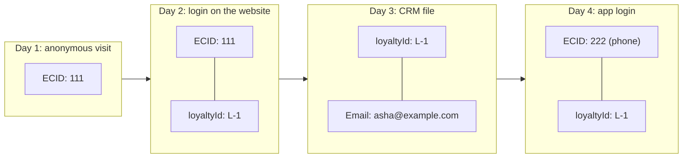
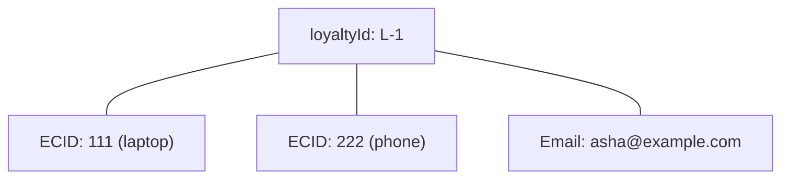
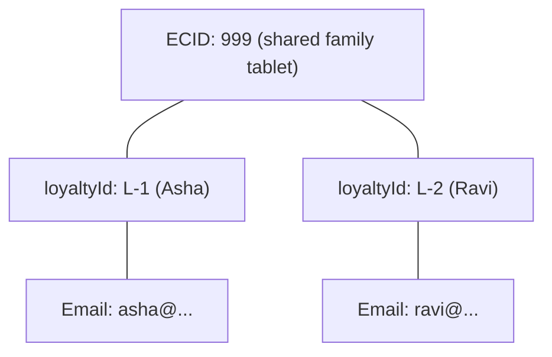

# Chapter 4: Identity Service

**Goal of this chapter:** you understand how AEP decides that a cookie, an email and a loyalty number belong to the same person; you can design an identity strategy; and you can spot and prevent "over-merged" profiles.

---

## 1. In plain words

Customers show up with different IDs in different systems:

- on the website: an anonymous cookie ID (**ECID**)
- after login: a **CRM ID** or **loyalty ID**
- in email: their **email address** (or a hashed version)
- in the app: a **device ID**

**Identity Service** links these IDs together into an **identity graph** for each person, so the Real-Time Customer Profile can merge all data that belongs to them.

The key rule: **two identities are linked when they arrive together in the same record or event.** If a login event contains both the ECID and the CRM ID, AEP links them. Data is never linked across people just because values look similar.

## 2. Why it matters on a project

Identity is where most AEP projects succeed or fail:

- **Under-merging**: the same person has several profiles. Audiences double-count; personalization misses known customers.
- **Over-merging (graph collapse)**: different people end up in one profile. Messages go to the wrong person; privacy risk.

A deliberate **identity strategy** is a mandatory design deliverable.

## 3. Key concepts

| Concept | Meaning |
| --- | --- |
| **Identity** | A value plus its namespace, e.g. `L-100234` in namespace `loyaltyId` |
| **Namespace** | The *type* of an identity: ECID, Email, Phone, a custom CRM ID... |
| **Identity type** | Category of a namespace: Cookie ID, Device ID, Cross-device ID, Email, Phone, Non-people identifier, Partner ID |
| **Primary identity** | The identity that decides which profile a record/event is stored against |
| **Identity graph** | All identities linked to one person (per organization, private to the client) |
| **Authenticated state** | `ambiguous`, `authenticated` or `loggedOut`, sent by Web/Mobile SDK in identityMap |
| **Identity graph linking rules** | Configuration that prevents graph collapse (unique namespaces + namespace priority) |

**Standard namespaces** include ECID, Email, Phone, hashed email/phone (SHA-256), mobile ad IDs (IDFA, GAID) and others. **Custom namespaces** are created for client IDs (CRM ID, loyalty ID). Namespaces are shared across sandboxes in the organization.

## 4. How a graph is built: example



Resulting graph for this person:



All events from ECID 111 (including Day 1 anonymous browsing) and ECID 222 now belong to one profile.

## 5. Over-merging: the classic failure



Asha and Ravi both logged in on the same tablet, so without rules AEP links them through ECID 999 into one graph. Other common causes:

- call-centre agents entering *their own* email or a default value for customers
- placeholder values: `unknown`, `test@test.com`, `0000000000`, `N/A`
- shared devices (kiosks, family devices, store tablets)
- recycled phone numbers

## 6. Identity graph linking rules (the fix)

Linking rules let you say *how a graph is allowed to look*:

| Setting | What it does |
| --- | --- |
| **Unique namespace** | A graph may contain at most **one** identity in this namespace (e.g. one CRM ID). If a new link would add a second one, the algorithm removes the older conflicting link instead of merging two people. Up to three unique namespaces. |
| **Namespace priority** | An ordered list of namespaces. Higher priority = more trusted. Used to decide which links to remove and, for ExperienceEvents, which identity becomes the primary identity. Person namespaces must rank above device/cookie namespaces. |
| **Identity optimization algorithm** | Applies these rules as new data arrives; the most recent link wins when there is a conflict. |
| **Graph simulation** | A UI tool to test how sample events would build a graph under your rules before you turn them on. |

With `loyaltyId` as a unique namespace in the tablet example, the tablet's ECID stays linked only to the most recent logged-in person, and Asha and Ravi keep separate profiles.

Important implementation notes from Adobe's guide:

- Settings apply to graphs when they are next updated; plan the activation and **wait at least 24 hours** after saving settings before ingesting data, per the implementation guide.
- Profile rejects ExperienceEvents carrying two or more identities of the highest-priority namespace.
- Design and test in a development sandbox with graph simulation first.

Docs: [Identity graph linking rules overview](https://experienceleague.adobe.com/en/docs/experience-platform/identity/features/identity-graph-linking-rules/overview) · [Namespace priority](https://experienceleague.adobe.com/en/docs/experience-platform/identity/features/identity-graph-linking-rules/namespace-priority) · [Implementation guide](https://experienceleague.adobe.com/en/docs/experience-platform/identity/features/identity-graph-linking-rules/implementation-guide) · [Graph simulation](https://experienceleague.adobe.com/en/docs/experience-platform/identity/features/identity-graph-linking-rules/graph-simulation)

## 7. Designing an identity strategy: step by step

1. **Inventory IDs** per source: which IDs exist, who owns them, how stable they are, which are personal.
2. **Pick the person ID**: the most stable cross-channel ID (CRM ID or loyalty ID) → custom namespace, usually unique and highest priority.
3. **Decide primary identity per dataset**: CRM datasets → CRM ID; web/app events → ECID in identityMap (with the person ID added when known).
4. **Add secondary identities** that create useful links (email on CRM records, CRM ID on login events).
5. **Decide hashing**: for advertising destinations, hashed email (SHA-256 of trimmed, lower-cased email); store raw email only if needed and labelled.
6. **Data quality rules**: reject or clean placeholders before ingestion (Data Prep or upstream).
7. **Configure graph linking rules**; test with graph simulation and sample data.
8. **Choose merge policy** for Profile (Chapter 7) consistent with the identity design.
9. **Document** everything in the identity strategy deliverable with examples.

Example identity matrix:

| Dataset | Primary identity | Secondary identities |
| --- | --- | --- |
| CRM customers (Profile) | crmId | email, phone, loyaltyId |
| Loyalty members (Profile) | loyaltyId | crmId |
| Web events (ExperienceEvent) | ECID (identityMap) | crmId on authenticated events |
| App events (ExperienceEvent) | ECID (identityMap) | crmId on authenticated events |
| POS transactions (ExperienceEvent) | loyaltyId | — |
| Email engagement (ExperienceEvent) | email | — |

## 8. In the UI: step by step

1. **Identities → Browse**: see standard and custom namespaces; **Create identity namespace** for client IDs (name, code, type).
2. **Identities → Identity graph viewer**: enter an identity (namespace + value) to see the linked graph, its links and sources.
3. **Identities → Settings** (graph linking rules): choose unique namespaces, drag namespaces into priority order, save.
4. **Graph simulation**: enter test events and see the resulting graphs.

## 9. Code in this repository

- [`code/api/identity_tools.py`](../code/api/identity_tools.py): list namespaces, create a custom namespace, normalize and SHA-256-hash emails/phones the way destinations expect.

```bash
python identity_tools.py list
python identity_tools.py create --name "CRM ID" --code crmId --type CROSS_DEVICE
python identity_tools.py hash-email " Asha.Rao@Example.com "
```

## 10. Guardrails to remember

Identity Service has documented limits, including a maximum number of identities in one graph and in one record; when a graph reaches its limit, older links are removed. Check the current numbers: [Identity Service guardrails](https://experienceleague.adobe.com/en/docs/experience-platform/identity/guardrails).

## 11. Common mistakes

| Mistake | Consequence | Better |
| --- | --- | --- |
| Email as the person ID when people share or change emails | Over/under-merging | Stable CRM/loyalty ID as the person anchor |
| Sending placeholder IDs ("unknown") | Massive graph collapse | Filter in Data Prep or upstream |
| Not sending the CRM ID on login events | Web history never joins the profile | Add the person ID to identityMap when authenticated |
| Inconsistent formats (case, spaces, country codes) | Same person, several identities | Normalize (lower-case, trim, E.164 phone) |
| Turning on linking rules in production first | Unexpected splits | Simulate, test in dev, then roll out |

## 12. Architect tips

- Write down the **"golden rule"** of the client's identity in one sentence, e.g. *"A person is a CRM ID; devices attach to the most recent logged-in CRM ID."*
- Ask early whether the client has **shared-device** scenarios (retail kiosks, households, B2B shared logins).
- For B2B, distinguish **person** identities from **account** identities.
- Monitor graph health regularly: graph size distribution, profiles with many identities.

## 13. Official docs and videos

- [Identity Service overview](https://experienceleague.adobe.com/en/docs/experience-platform/identity/home)
- [Identity graph linking rules](https://experienceleague.adobe.com/en/docs/experience-platform/identity/features/identity-graph-linking-rules/overview)
- [Example configurations](https://experienceleague.adobe.com/en/docs/experience-platform/identity/features/identity-graph-linking-rules/example-configurations)
- [Identity optimization algorithm](https://experienceleague.adobe.com/en/docs/experience-platform/identity/features/identity-graph-linking-rules/identity-optimization-algorithm)
- [Troubleshooting linking rules](https://experienceleague.adobe.com/en/docs/experience-platform/identity/features/identity-graph-linking-rules/troubleshooting)
- [Using identityMap in data collection](https://experienceleague.adobe.com/en/docs/experience-platform/collection/identity/identity-map)
- [Webinar recording: Identity graph use cases and troubleshooting](https://experienceleague.adobe.com/en/docs/events/adobe-customer-success-webinar-recordings/2025/aep2025/identity-graph)
- [Identity Service guardrails](https://experienceleague.adobe.com/en/docs/experience-platform/identity/guardrails)

## 14. Check yourself

1. When does AEP link two identities?
2. What is over-merging, and name two causes.
3. What does marking `crmId` as a unique namespace achieve?
4. Which identity should be primary for web events, and what should be added after login?
5. How should an email be prepared before hashing for an advertising destination?

<details>
<summary>Answers</summary>

1. When they appear together in the same record or event.
2. Different people merged into one profile; shared devices, placeholder values, agents entering their own email, recycled phone numbers.
3. A graph can never contain two CRM IDs; conflicting links are removed instead of merging two people.
4. ECID as primary; add the person ID (CRM/loyalty) in identityMap with `authenticated` state.
5. Trim spaces, lower-case, then SHA-256 hash (hex).
</details>

---

Previous: [Chapter 3](03-xdm-data-modeling.md) · Next: [Chapter 5: Data ingestion](05-data-ingestion.md)
