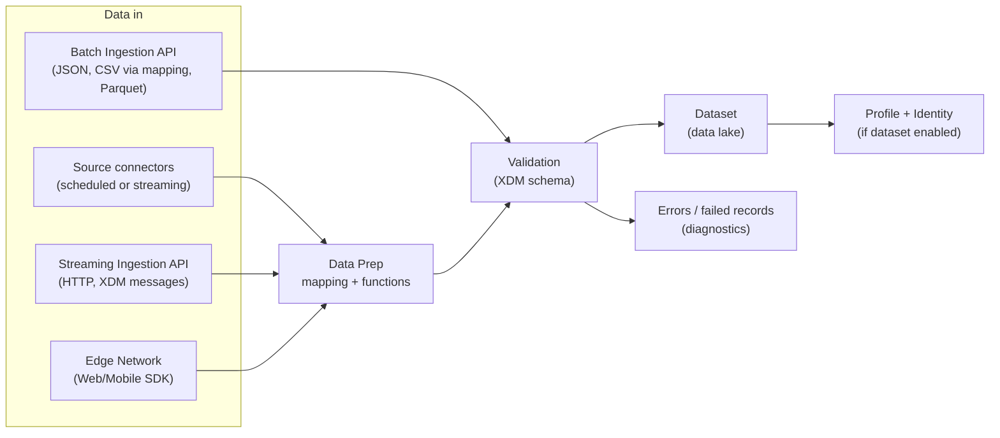

# Chapter 5: Data ingestion

**Goal of this chapter:** you can choose the right way to bring data into AEP, map it to XDM, load it by batch or streaming, monitor it, and fix failed loads.

---

## 1. In plain words

Ingestion is how data gets **into datasets**. There are three families:

1. **Sources** (connectors): configure in the UI, AEP pulls data on a schedule or receives a stream (S3, Azure Blob, Google Cloud Storage, SFTP, Snowflake, BigQuery, Salesforce, Marketo, Adobe Analytics, Kafka, HTTP API...).
2. **APIs**: your code pushes data: **Batch Ingestion API** (files) and **Streaming Ingestion API** (records/events over HTTP).
3. **Data collection** (Edge Network): Web SDK, Mobile SDK, Edge Server API (Chapter 6).

On the way in, **Data Prep** maps source fields to XDM and transforms values.

## 2. Why it matters on a project

Most project time goes into data: getting it in on time, in the right shape, with clean identities. Data engineers own this, but every role must understand failure modes, latency and volume limits.

## 3. The ingestion picture



## 4. Choosing an ingestion method

| Situation | Method |
| --- | --- |
| Client already drops daily files in S3/Azure/SFTP | Cloud storage **source** with schedule and Data Prep mapping |
| Data lives in Snowflake/BigQuery/Databricks | Database **source**, or **Federated Audience Composition** if you only need audiences without copying data |
| SaaS apps (Salesforce, Marketo, Microsoft Dynamics, ServiceNow...) | Corresponding **source connector** |
| Real-time events from a backend (order placed, call ended) | **HTTP API streaming source** / Streaming Ingestion API |
| Event bus (Kafka, Kinesis, Event Hubs) | Streaming source connectors for those platforms |
| Website and app behaviour | **Web SDK / Mobile SDK** (Chapter 6) |
| One-off backfill or custom ETL tool | **Batch Ingestion API** |
| Adobe Analytics history | **Analytics source connector** |

The full catalog is in **Sources** in the UI and in the [Sources overview](https://experienceleague.adobe.com/en/docs/experience-platform/sources/home).

## 5. Data Prep: mapping and transforming

Data Prep maps incoming fields to XDM fields and can apply functions, so you rarely need an extra ETL step for simple transformations.

| Need | Data Prep example |
| --- | --- |
| Lower-case an email | `lower(email)` |
| Trim spaces | `trim(first_name)` |
| Combine fields | `concat(first_name, " ", last_name)` |
| Conditional value | `iif(points > 5000, "gold", "silver")` |
| Parse a date | `date(join_date, "yyyy-MM-dd")` |
| Hash a value | `sha256(lower(trim(email)))` |
| Constant value | a constant mapping (e.g. `"CRM"` into a source field) |
| Drop placeholder IDs | conditional mapping to null when value is `"unknown"` |

Check the exact function names in the [Data Prep functions reference](https://experienceleague.adobe.com/en/docs/experience-platform/data-prep/functions).

**Calculated fields** and **mapping sets** can be reused across dataflows. For streaming sources, Data Prep also supports **partial row updates** (upserts) so a stream can update only some Profile attributes.

## 6. Batch ingestion: how it works

1. **Create a batch** for a dataset (says which format: JSON, Parquet; CSV needs a mapping/source).
2. **Upload** one or more files into the batch.
3. **Complete** the batch. Only now does AEP start processing.
4. AEP **validates** each record against the schema; valid rows go to the dataset; with **partial ingestion** enabled, bad rows are skipped up to an error threshold.
5. If the dataset is Profile-enabled, records flow on to **Identity** and **Profile**.

```http
POST /data/foundation/import/batches
{ "datasetId": "<DATASET_ID>", "inputFormat": { "format": "json", "isMultiLineJson": true } }

PUT  /data/foundation/import/batches/<BATCH_ID>/datasets/<DATASET_ID>/files/members.json
Content-Type: application/octet-stream
<file bytes>

POST /data/foundation/import/batches/<BATCH_ID>?action=COMPLETE
```

Then poll `GET /data/foundation/catalog/batches/<BATCH_ID>` until the status is `success` or `failed`.

Limits from Adobe's batch docs: up to 25,000 files and 1 TB per batch, with best practice under 100 GB and 10,000 files. Profile and event batches are also limited per day (Chapter 2 guardrails), so **combine small files into fewer batches**.

Script: [`code/api/batch_ingest.py`](../code/api/batch_ingest.py)

## 7. Streaming ingestion: how it works

1. Create an **HTTP API streaming connection** (Sources → HTTP API). You get an **inlet URL** on `dcs.adobedc.net`. Choose authenticated (token required, recommended) or unauthenticated.
2. Create a **dataflow** to a dataset (optionally with Data Prep mapping for raw JSON).
3. Your system POSTs XDM messages to the inlet:

```json
{
  "header": {
    "schemaRef": { "id": "<SCHEMA_$ID>", "contentType": "application/vnd.adobe.xed-full+json;version=1" },
    "imsOrgId": "<ORG_ID>@AdobeOrg",
    "datasetId": "<DATASET_ID>",
    "flowId": "<FLOW_ID>"
  },
  "body": {
    "xdmMeta": { "schemaRef": { "id": "<SCHEMA_$ID>", "contentType": "application/vnd.adobe.xed-full+json;version=1" } },
    "xdmEntity": { "_<TENANT_ID>": { "loyalty": { "loyaltyId": "L-100234", "tier": "gold" } } }
  }
}
```

4. Use `?syncValidation=true` during development to get validation errors in the response (don't use it in production; it is slower).
5. Multiple messages can be sent in one request to the batch endpoint of the inlet.

Data typically reaches Profile within seconds to minutes; the data lake receives streamed data in micro-batches.

Script: [`code/api/stream_record.py`](../code/api/stream_record.py)

## 8. Monitoring and fixing failures

| Where | What you see |
| --- | --- |
| **Datasets → dataset → batches** | Each batch with status, records ingested/failed |
| **Sources → Dataflows → dataflow runs** | Run status, records, errors per run |
| **Monitoring dashboard** | Ingestion, identity and profile processing across sandboxes |
| **Alerts** | Subscribe to ingestion failure/delay alerts (UI or I/O Events) |
| **Error diagnostics** | Download failed records and error codes |

Typical errors and fixes:

| Error | Usual cause | Fix |
| --- | --- | --- |
| Type mismatch | String in a number field, wrong date format | Fix mapping/function; validate source |
| Missing required field | `_id` or `timestamp` missing on events | Map or generate them |
| Missing identity | No primary identity value | Ensure the identity field is populated; filter rows without it |
| Event too large | > 10 KB per ExperienceEvent | Remove unneeded fields; reduce arrays |
| Unknown schema / org | Wrong schemaRef or imsOrgId in a streaming header | Copy values from the dataset/connection |
| Batch stuck "loading" | Batch never completed | Call `action=COMPLETE` |

## 9. Updates, deletes and retention

- **Profile records**: a new record with the same primary identity **overwrites** attributes it contains (merging rules apply; Chapter 7). Streaming **upserts** update only the fields sent.
- **Events** are append-only. Correcting history means deleting and re-ingesting.
- **Deleting data**: delete a batch (removes it from the lake and Profile), use **Data Lifecycle / data hygiene** record delete for specific identities, or Privacy Service for data-subject requests (Chapter 14).
- **Retention**: set **Experience Event expiration** for Profile and dataset retention for the lake to control size and licence usage.

## 10. Step by step: a CRM file from S3 (UI)

1. **Sources → Amazon S3 → Set up**: enter credentials (role ARN or keys), test connection.
2. Browse to the folder, choose the file format (CSV, JSON, Parquet), preview.
3. Choose **existing dataset** (e.g. "Acme - Loyalty Members - CRM") or create one.
4. **Mapping**: map columns to XDM fields; add functions (lower email, map tier values); check required fields and the identity.
5. **Scheduling**: frequency (e.g. daily at 02:00), start time, backfill on/off; incremental loads usually rely on new files per run.
6. Review and **Finish**; watch the first dataflow run; open the dataset to verify rows and a sample profile.

Hands-on lesson: [Ingest batch data](https://experienceleague.adobe.com/en/docs/platform-learn/getting-started-for-data-architects-and-data-engineers/ingest-batch-data)

## 11. Common mistakes

| Mistake | Better |
| --- | --- |
| Many tiny batches per hour | Fewer, larger batches (daily batch guardrail) |
| Raw data with placeholders straight into Profile | Clean in Data Prep or upstream |
| Using sync validation in production streams | Only for development |
| No alerting | Alerts on failed/delayed dataflows from day one |
| Re-ingesting full history daily into Profile | Incremental files; full refresh only when needed |

## 12. Architect tips

- For each source, document: owner, method, frequency, volume/day, latency need, primary identity, dataset, Profile on/off, retention, error handling.
- Prefer **sources and Data Prep** over custom ETL when possible: less to maintain.
- Use the **Streaming Ingestion API** only when the latency need justifies it; batch is simpler and cheaper.
- Consider **Federated Audience Composition** if the client's warehouse is the source of truth and they don't want to copy data.

## 13. Official docs and videos

- [Data ingestion overview](https://experienceleague.adobe.com/en/docs/experience-platform/ingestion/home)
- [Sources overview](https://experienceleague.adobe.com/en/docs/experience-platform/sources/home)
- [Batch Ingestion API guide](https://experienceleague.adobe.com/en/docs/experience-platform/ingestion/batch/api-overview)
- [Partial batch ingestion](https://experienceleague.adobe.com/en/docs/experience-platform/ingestion/batch/partial)
- [Batch ingestion troubleshooting](https://experienceleague.adobe.com/en/docs/experience-platform/ingestion/batch/troubleshooting)
- [Create an HTTP API streaming connection](https://experienceleague.adobe.com/en/docs/experience-platform/sources/api-tutorials/create/streaming/http)
- [Stream record data](https://experienceleague.adobe.com/en/docs/experience-platform/ingestion/tutorials/streaming-record-data) · [Stream time-series data](https://experienceleague.adobe.com/en/docs/experience-platform/ingestion/tutorials/streaming-time-series-data)
- [Streaming ingestion troubleshooting](https://experienceleague.adobe.com/en/docs/experience-platform/ingestion/streaming/troubleshooting)
- [Data Prep overview](https://experienceleague.adobe.com/en/docs/experience-platform/data-prep/home) · [Data Prep functions](https://experienceleague.adobe.com/en/docs/experience-platform/data-prep/functions)
- [Ingestion guardrails](https://experienceleague.adobe.com/en/docs/experience-platform/ingestion/guardrails)
- [Hands-on: Ingest batch data](https://experienceleague.adobe.com/en/docs/platform-learn/getting-started-for-data-architects-and-data-engineers/ingest-batch-data)

## 14. Check yourself

1. Which three steps make a batch upload, and which one people forget?
2. When would you choose streaming over batch for CRM updates?
3. Name four Data Prep functions and what they do.
4. A dataflow shows 2% failed records. Where do you find out why?
5. How do you remove one wrong batch completely?

<details>
<summary>Answers</summary>

1. Create batch → upload files → complete batch (the complete call is the one forgotten).
2. When a use case needs the change within minutes (e.g. tier upgrade triggering a journey); otherwise batch.
3. `lower` (lower-case), `trim` (remove spaces), `concat` (join values), `iif` (conditional), `sha256` (hash), `date` (parse dates).
4. The dataflow run / batch details and the error diagnostics download.
5. Delete the batch (Datasets → batch → delete, or Catalog/Batch API); it is removed from the lake and Profile.
</details>

---

Previous: [Chapter 4](04-identity-service.md) · Next: [Chapter 6: Data collection](06-data-collection.md)
