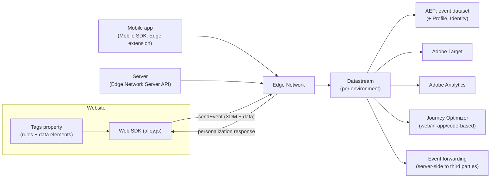

# Chapter 6: Data collection: Web SDK, Mobile SDK, datastreams, Tags

**Goal of this chapter:** you understand how website and app behaviour reaches AEP, can read and change a Web SDK implementation, configure a datastream, handle identity and consent on the page, and debug missing data.

---

## 1. In plain words

To collect behaviour from websites and apps, Adobe uses one pipeline: the **Edge Network**.

- On the website, the **Web SDK** (a JavaScript library called *alloy.js*) sends events.
- In apps, the **Mobile SDK** (iOS, Android, React Native, Flutter) sends events.
- From servers, the **Edge Network Server API** sends events.

Every call goes to a **datastream**, a configuration in AEP that says *where this data should go*: AEP datasets, Adobe Target, Adobe Analytics, Journey Optimizer, event forwarding to third parties. One call from the page can feed all of them.

**Tags** (formerly Adobe Launch) is the tag manager used to deploy the Web SDK and define *when* to send which data, without code releases.

## 2. Why it matters on a project

Web and app data drives most real-time use cases (browse abandonment, cart abandonment, on-site personalization) and is usually the **largest data volume**. Mistakes here show up as missing events, wrong identities, consent violations or slow pages.

## 3. How it fits together



## 4. Key building blocks

| Block | What it is | Where configured |
| --- | --- | --- |
| **XDM ExperienceEvent schema** | Schema for web/app events; add the **AEP Web SDK ExperienceEvent** field group (and Commerce, Web details...) | Schemas |
| **Event dataset** | Dataset on that schema, usually Profile-enabled | Datasets |
| **Datastream** | ID used by the SDK; maps to services (AEP datasets, Target, Analytics, AJO...); separate datastreams per environment (dev/stage/prod) | Data Collection → Datastreams |
| **Tags property** | Web SDK extension config + rules that fire events | Data Collection → Tags |
| **ECID** | Experience Cloud ID: anonymous device/browser identity, set by the Edge Network | Automatic |
| **identityMap** | Identities sent with an event (ECID, CRM ID after login) | In the event |
| **data object** | Free-form data for Analytics or other services that don't need XDM | In the event |

## 5. The Web SDK in code

Two ways to deploy: through the **Tags Web SDK extension** (most common) or **directly in code** (npm package `@adobe/alloy` or the script). The commands are the same.

```html
<!-- 1. Base code: defines the alloy() queue before the library loads -->
<script>
  !function(n,o){o.forEach(function(o){n[o]||((n.__alloyNS=n.__alloyNS||[]).push(o),n[o]=
  function(){var u=arguments;return new Promise(function(i,l){n.setTimeout(function(){n[o].q.push([i,l,u])})})},
  n[o].q=[])})}(window,["alloy"]);
</script>
<!-- 2. Library (check the docs for the current version; 2.37.1 was latest stable in Nov 2026) -->
<script src="https://cdn1.adoberesources.net/alloy/2.37.1/alloy.min.js" async></script>
<script>
  // 3. Configure once per page
  alloy("configure", {
    datastreamId: "<DATASTREAM_ID>",
    orgId: "<ORG_ID>@AdobeOrg",
    defaultConsent: "pending",           // wait for the consent banner (see section 7)
    clickCollectionEnabled: true
  });

  // 4. Page view with personalization
  alloy("sendEvent", {
    renderDecisions: true,               // let the SDK render Target/AJO web experiences
    xdm: {
      eventType: "web.webpagedetails.pageViews",
      web: { webPageDetails: { name: "Home", URL: window.location.href, pageViews: { value: 1 } } }
    }
  });
</script>
```

More complete examples (login identity, product view, add to cart, purchase, consent, Edge Delivery Services site) are in [`code/web-sdk`](../code/web-sdk).

### Identity on the page

After the user logs in, add the person ID so web history joins the CRM profile (Chapter 4):

```js
alloy("sendEvent", {
  xdm: {
    eventType: "userAccount.login",
    identityMap: {
      crmId: [{ id: "CRM-778899", authenticatedState: "authenticated", primary: false }]
    }
  }
});
```

ECID is added automatically. Send the person ID **on every event while logged in** (or at least at login and key events), as agreed in the identity strategy.

## 6. Datastreams: step by step

1. **Data Collection → Datastreams → New datastream**: name it `<brand>-web-<env>`, choose the event schema.
2. **Add service → Adobe Experience Platform**: select the **event dataset** (and profile dataset if you collect profile attributes); enable **Edge segmentation** and **Personalization destinations** if you need same-page personalization; enable **Adobe Journey Optimizer** if you use AJO web/in-app.
3. **Add service → Adobe Target / Adobe Analytics / Event Forwarding** as needed.
4. Optional: **Data Prep for Data Collection** to map the `data` object to XDM inside the datastream.
5. Create one datastream per environment and use the matching ID in the dev/stage/prod Tags environments.
6. **Datastream overrides** (`edgeConfigOverrides`) can switch datasets or report suites per call, e.g. per country site.

## 7. Consent

- Set `defaultConsent: "pending"` so nothing is sent until the visitor decides (or `"in"` where allowed by law).
- When the consent banner (OneTrust, Didomi, the client's own CMP) returns a choice, call `setConsent` using the **Adobe standard** (or IAB TCF 2.0) format:

```js
alloy("setConsent", {
  consent: [{
    standard: "Adobe", version: "2.0",
    value: { collect: { val: "y" }, marketing: { preferred: "email", any: { val: "y" } } }
  }]
});
```

- Store consent on the profile (Consents and Preferences field group) so audiences and destinations can respect it (Chapter 14).

## 8. Mobile SDK and Server API (short)

- **Mobile SDK**: add the *Edge Network*, *Identity for Edge Network*, *Consent* and *Assurance* extensions; configure with a Tags **mobile property** and a datastream; send `ExperienceEvent`s with XDM. Docs: [Mobile SDK](https://developer.adobe.com/client-sdks/home/).
- **Edge Network Server API**: POST events from a server (call centre, kiosk, IoT, server-side rendering) to the `interact` (real-time) or `collect` (fire-and-forget) endpoints with a datastream ID. Docs: [Data Collection APIs](https://developer.adobe.com/data-collection-apis/docs/getting-started/) · [interact endpoint](https://developer.adobe.com/data-collection-apis/docs/endpoints/interact/).
- **Event forwarding**: a server-side Tags property that sends Edge data on to third parties (e.g. a CAPI) without extra browser tags.

## 9. Debugging missing or wrong data: step by step

1. **Browser DevTools → Network**: filter `interact` or `collect`: is the request sent? Status 200? Which datastream ID?
2. **Adobe Experience Platform Debugger** (browser extension): see Web SDK events, XDM payload, Tags rules that fired, Edge trace.
3. **Assurance** (also for web): session view of every event and the services it reached, with validation.
4. **Datastream**: is the AEP service enabled with the right dataset? Is this the right environment's datastream?
5. **Dataset**: did batches arrive? Any failed records (schema mismatch, missing `_id`/`timestamp`, size > 10 KB)?
6. **Profile**: look up the ECID or CRM ID; check events on the profile.
7. **Consent**: was collection blocked by `pending`/`out`?

## 10. Common mistakes

| Mistake | Better |
| --- | --- |
| One datastream for all environments | One per environment; Tags environments map to them |
| Sending the whole data layer as XDM | Model only what you use; respect the 10 KB event size |
| Using the email as primary identity in identityMap | ECID primary; person ID as authenticated secondary (per strategy) |
| Firing events before consent | `defaultConsent: "pending"` + `setConsent` |
| Loading Target/Analytics libraries alongside the Web SDK | Web SDK replaces at.js/AppMeasurement; migrate, don't double-tag |
| Ignoring page performance | Load async; avoid render-blocking; use pre-hiding snippets carefully |

## 11. Architect tips

- Design the **event taxonomy** (eventType values, required fields per event) as a deliverable, like the data dictionary.
- Use **one Web SDK call per page** for page view + personalization; use additional calls for interactions.
- Consider **first-party device IDs (FPID)** and first-party domains (CNAME) for cookie longevity; involve the privacy team.
- For AEM sites, Tags is usually added through the page component or the AEM cloud configuration; for Edge Delivery Services sites, load martech in the "delayed" phase to protect Core Web Vitals (example in [`code/web-sdk`](../code/web-sdk)).

## 12. Official docs and videos

- [Web SDK overview](https://experienceleague.adobe.com/en/docs/experience-platform/web-sdk/home)
- [sendEvent command](https://experienceleague.adobe.com/en/docs/experience-platform/collection/js/commands/sendevent/overview)
- [Using identityMap in data collection](https://experienceleague.adobe.com/en/docs/experience-platform/collection/identity/identity-map)
- [Datastream overrides (edgeConfigOverrides)](https://experienceleague.adobe.com/en/docs/experience-platform/web-sdk/commands/datastream-overrides)
- [Datastreams overview](https://experienceleague.adobe.com/en/docs/experience-platform/datastreams/overview)
- [Tags overview](https://experienceleague.adobe.com/en/docs/experience-platform/tags/home)
- [Web SDK extension release notes](https://experienceleague.adobe.com/en/docs/experience-platform/tags/extensions/client/web-sdk/web-sdk-ext-release-notes)
- [Tutorial: Implement Adobe Experience Cloud with Web SDK](https://experienceleague.adobe.com/en/docs/platform-learn/implement-web-sdk/overview)
- [Migrate from AppMeasurement to the Web SDK](https://experienceleague.adobe.com/en/docs/analytics/implementation/aep-edge/web-sdk/appmeasurement-to-web-sdk)
- [Migrate Target from at.js 2.x to Web SDK](https://experienceleague.adobe.com/en/docs/platform-learn/migrate-target-to-websdk/send-parameters)
- [Mobile SDK documentation](https://developer.adobe.com/client-sdks/home/)
- [Edge Network Server API: getting started](https://developer.adobe.com/data-collection-apis/docs/getting-started/)

## 13. Check yourself

1. What does a datastream decide?
2. Why use `defaultConsent: "pending"`?
3. A login event: which identities do you send, and which is primary?
4. Events appear in the Debugger but not in the dataset. Name three things to check.
5. Why load martech in the delayed phase on an Edge Delivery Services site?

<details>
<summary>Answers</summary>

1. Which services and datasets receive the data sent with that datastream ID (AEP, Target, Analytics, AJO, event forwarding), per environment.
2. So no data is collected before the visitor consents.
3. ECID (primary, automatic) plus the person ID (CRM/loyalty) as authenticated.
4. Datastream has the AEP service and right dataset; correct environment's datastream ID; failed records in the dataset (schema mismatch, missing `_id`/`timestamp`, size); consent state.
5. To keep Core Web Vitals (LCP) fast; tags load after the main content.
</details>

---

Previous: [Chapter 5](05-data-ingestion.md) · Next: [Chapter 7: Real-Time Customer Profile](07-real-time-customer-profile.md)
