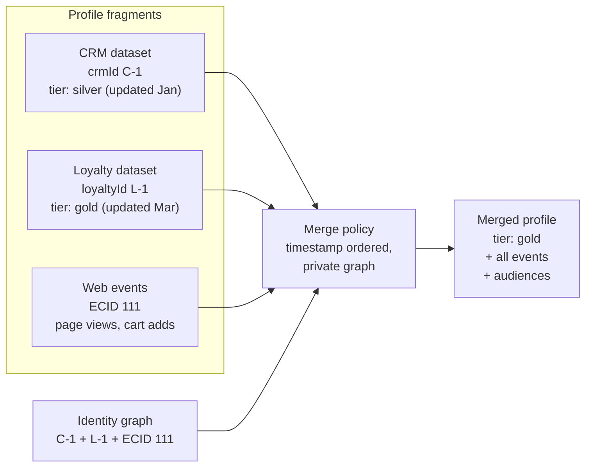

# Chapter 7: Real-Time Customer Profile

**Goal of this chapter:** you understand how a profile is assembled from many datasets, how merge policies decide "which value wins", how to keep profiles lean, and how to look up and validate profiles in the UI and by API.

---

## 1. In plain words

The **Real-Time Customer Profile** is AEP's live, merged view of each person. It combines:

- **attributes** from Profile-class datasets (CRM, loyalty, preferences)
- **events** from ExperienceEvent datasets (web, app, purchases, email engagement)
- **audience memberships** (which audiences the person is in)
- **identities** from the identity graph

It is used for segmentation, activation, journeys and real-time personalization.

## 2. Why it matters on a project

Every audience, destination and journey reads profiles. If profiles are incomplete, duplicated, over-merged or bloated, every downstream use case suffers. Profile size also drives licence cost (addressable audience and "profile richness").

## 3. How a profile is assembled

Data is stored as **profile fragments**: one fragment per dataset per primary identity. At read time (lookup, segmentation, activation), AEP:

1. finds all identities in the person's **identity graph** (if the merge policy uses identity stitching),
2. collects all fragments for those identities across Profile-enabled datasets,
3. resolves conflicting attribute values with the **merge policy**,
4. returns one merged profile (attributes + events + audience memberships).



Because profiles are **merged on read**, changing a merge policy changes results immediately, without re-ingestion.

## 4. Merge policies

A merge policy has two decisions:

| Decision | Options | Meaning |
| --- | --- | --- |
| **ID stitching** | **Private graph** | Use the identity graph to merge fragments of the same person (normal choice) |
| | **None** | No stitching: only fragments with the same identity merge (each identity can be a separate profile) |
| **Attribute merge** | **Timestamp ordered** (default) | The most recently updated value wins; all datasets used |
| | **Dataset precedence** | Values from higher-ranked datasets win; **datasets not listed are excluded** |

Other settings:

- **Default merge policy** for the sandbox (used when none is chosen).
- **Active-on-edge** merge policy: the one used for edge segmentation and edge profiles (one per sandbox).
- Privacy requests are processed with a non-stitched view (Chapter 14).

**When to use dataset precedence:** when one source is the agreed "system of record" for attributes, e.g. consent from the consent platform must always beat values from other sources, or CRM must beat web-form values. Otherwise use timestamp ordering.

Example API payload:

```json
{
  "name": "Acme - default - private graph, timestamp",
  "identityGraph": { "type": "pdg" },
  "attributeMerge": { "type": "timestampOrdered" },
  "schema": { "name": "_xdm.context.profile" },
  "default": true,
  "activeOnEdge": true
}
```

Dataset precedence variant:

```json
"attributeMerge": { "type": "dataSetPrecedence", "order": ["<CONSENT_DATASET_ID>", "<CRM_DATASET_ID>", "<WEB_PROFILE_DATASET_ID>"] }
```

## 5. Computed attributes

**Computed attributes** are profile fields that AEP calculates from events, such as:

- total spend in the last 30 days (SUM)
- number of purchases in the last 90 days (COUNT)
- most recent product category viewed (MOST_RECENT)
- first or last purchase date (MIN / MAX)

They are kept up to date by AEP, can be used in audiences, journeys and personalization (including on the edge), and avoid writing complex event logic in every audience. Define them in **Customer → Profiles → Computed attributes** with a function, an event filter and a lookback window (check the docs for supported functions and maximum lookback).

## 6. Keeping profiles lean (and within licence)

| Lever | What it does |
| --- | --- |
| Profile-enable only datasets used by audiences/activation | Analytics-only data stays in the lake |
| **Experience Event expiration** (per dataset) | Old events drop out of Profile automatically (e.g. 90 days) |
| **Pseudonymous profile data expiration** | Deletes anonymous (e.g. ECID-only) profiles that haven't been active for N days |
| Computed attributes instead of raw history | Keep "total spend 12 months" instead of every event |
| Avoid large arrays and unused fields | Respect 10 KB events, smaller profiles |
| Monitor Profile dashboard | Watch profile count, profiles by namespace, single-identity profiles |

## 7. In the UI: step by step

1. **Customer → Profiles → Overview (dashboard)**: profile count, growth, profiles by identity, single-identity profiles, audience overlap.
2. **Profiles → Browse**: choose a merge policy, select a namespace (e.g. `Email`) and enter a value → open the profile.
3. On a profile: **Attributes**, **Events**, **Audience membership**, and the identity graph link.
4. **Profiles → Merge policies**: view/create policies, mark default and active-on-edge.
5. **Profiles → Computed attributes**: create and monitor.
6. **Datasets → dataset → Profile toggle**: enable a dataset (only with a Profile-enabled schema and a primary identity).

## 8. Profile API (code)

[`code/api/profile_lookup.py`](../code/api/profile_lookup.py) shows:

```http
# Merged profile by identity
GET /data/core/ups/access/entities?schema.name=_xdm.context.profile&entityId=asha.rao@example.com&entityIdNS=Email

# Events for that person
GET /data/core/ups/access/entities?schema.name=_xdm.context.experienceevent
    &relatedSchema.name=_xdm.context.profile&relatedEntityId=L-100234&relatedEntityIdNS=loyaltyId

# Merge policies
GET /data/core/ups/config/mergePolicies
```

```bash
python profile_lookup.py --ns Email --id asha.rao@example.com
python profile_lookup.py --ns loyaltyId --id L-100234 --events
python profile_lookup.py --merge-policies
```

Use the lookup API for **testing and support**, not for high-volume real-time reads from websites; use edge personalization or the Edge Network for that.

## 9. Validating profiles after a change (checklist)

- [ ] Look up 3-5 known test persons by each identity namespace; attributes as expected?
- [ ] Identity graph of each test person: expected identities only, no strangers?
- [ ] Events visible with correct timestamps and event types?
- [ ] Audience memberships update as expected (batch next day, streaming within minutes)?
- [ ] Profile dashboard: total count and single-identity profiles within expected range?
- [ ] Query Service cross-check: counts per dataset vs profile counts by namespace?

## 10. Common mistakes

| Mistake | Consequence | Better |
| --- | --- | --- |
| Profile-enabling raw clickstream with long history | Huge profiles, slow audiences, licence overage | Expiration + lake-only raw data |
| Dataset precedence without listing all datasets | Attributes silently missing | List every dataset that should contribute |
| Different merge policy in audience vs destination | Inconsistent counts | Agree on one default; document exceptions |
| No ID stitching (None) by accident | Many duplicate profiles | Private graph for person-level use cases |
| Using the profile API as a website backend | Throttling, latency | Edge personalization / Edge Network |

## 11. Architect tips

- Document per dataset: Profile on/off, primary identity, expected update frequency, event expiration.
- Decide merge policies with the **business owners of the data** (who is the source of truth for each attribute?).
- Prefer **computed attributes** for common behavioural metrics; they simplify audiences and work on the edge.
- Plan **pseudonymous profile expiration** early for sites with heavy anonymous traffic.

## 12. Official docs and videos

- [Real-Time Customer Profile overview](https://experienceleague.adobe.com/en/docs/experience-platform/profile/home)
- [Profile UI guide](https://experienceleague.adobe.com/en/docs/experience-platform/profile/ui/user-guide)
- [Merge policies overview](https://experienceleague.adobe.com/en/docs/experience-platform/profile/merge-policies/overview)
- [Merge policies API](https://experienceleague.adobe.com/docs/experience-platform/profile/api/merge-policies.html?lang=en)
- [Planning for Profile enablement](https://experienceleague.adobe.com/en/docs/experience-platform/xdm/schema/profile-enablement-planning)
- [Hands-on: Create merge policies](https://experienceleague.adobe.com/en/docs/platform-learn/getting-started-for-data-architects-and-data-engineers/create-merge-policies)
- [Computed attributes overview](https://experienceleague.adobe.com/en/docs/experience-platform/profile/computed-attributes/overview)
- [Profile and segmentation guardrails](https://experienceleague.adobe.com/en/docs/experience-platform/profile/guardrails)
- [Profile API reference](https://developer.adobe.com/experience-platform-apis/references/profile)

## 13. Check yourself

1. What is a profile fragment?
2. Timestamp ordered vs dataset precedence: when would you use each?
3. Why do merge policy changes not need re-ingestion?
4. Name three ways to keep profiles lean.
5. Which merge policy does edge segmentation use?

<details>
<summary>Answers</summary>

1. The data from one dataset for one primary identity; profiles are merged from fragments at read time.
2. Timestamp ordered when the latest value should win (default); dataset precedence when a specific source is the system of record (e.g. consent platform, CRM).
3. Profiles are merged on read using the policy chosen at that time.
4. Profile-enable only needed datasets, Experience Event expiration, pseudonymous profile expiration (also computed attributes, smaller events).
5. The merge policy marked active-on-edge.
</details>

---

Previous: [Chapter 6](06-data-collection.md) · Next: [Chapter 8: Audiences and segmentation](08-audiences-segmentation.md)
