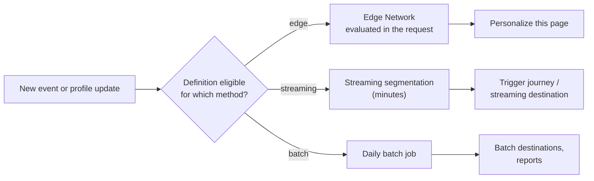

# Chapter 8: Audiences and segmentation

**Goal of this chapter:** you can build audiences in the UI and by API, choose the right evaluation method (batch, streaming, edge), understand all audience origins, and validate audience counts.

---

## 1. In plain words

An **audience** is a group of profiles that match a definition, e.g. *"gold loyalty members in the UK who viewed running shoes in the last 7 days but didn't buy"*. (Older docs say "segment"; Adobe now uses "audience" for the group and "segment definition" for the rule.)

Audiences are used to:

- send people to **destinations** (ads, email, CRM)
- start or branch **journeys** in Journey Optimizer
- **personalize** web/app experiences (Target, AJO)
- **analyse** in CJA and dashboards

## 2. Why it matters on a project

Most business use cases end up as "an audience + an activation". Audience timing (daily vs minutes vs same page) is a key design decision because it drives ingestion, identity and licence choices.

## 3. Evaluation methods

| Method | When it updates | Good for | Limits |
| --- | --- | --- | --- |
| **Batch** | Once a day (scheduled job), or on demand | Large, complex audiences; reports; daily activation | Not real time |
| **Streaming** | Within minutes as data arrives | Triggers: cart abandonment, tier change, recent behaviour | Only certain query patterns qualify |
| **Edge** | Instantly on the Edge Network during the visit | Same-page/next-page personalization | Simple rules (e.g. single event within 24h, profile attributes, other audiences); uses the active-on-edge merge policy |

AEP tells you in the Segment Builder whether a definition is eligible for streaming or edge.



## 4. Audience origins (where audiences come from)

| Origin | What it is |
| --- | --- |
| **Segmentation Service** | Built with Segment Builder or the API using PQL on Profile data |
| **Custom upload (externally generated)** | Import a list (CSV) of IDs from another system as an audience |
| **Audience Composition** | Visual canvas to combine/split/exclude audiences, rank, enrich with attributes |
| **Federated Audience Composition** | Build audiences directly on the client's warehouse (Snowflake, BigQuery, Databricks, Redshift, Teradata...) without copying all data into AEP |
| **Data Distiller audiences** | Audiences created with SQL in Query Service |
| **Lookalike audiences** (Real-Time CDP, by licence) | AI-generated audiences similar to a base audience |
| **Account audiences** (B2B) | Audiences of companies/accounts |

All of them appear in the **Audience Portal**, the central inventory where you browse, tag, folder, check size and see where each audience is activated.

## 5. Building an audience in the UI: step by step

1. **Customer → Audiences → Create audience → Build rule** (Segment Builder).
2. Left panel: **Attributes** (profile fields), **Events** (event fields and event types), **Audiences** (reuse other audiences).
3. Drag fields to the canvas:
   - attribute rule: `Loyalty → tier equals gold`
   - event rule: `Event type equals commerce.productViews` **in the last 7 days**, `productListItems.name contains "Run"`
   - exclusion: **Exclude** event `commerce.purchases` in the last 7 days
4. Choose the **merge policy** (top of the canvas).
5. Watch **estimated qualified profiles** and the **evaluation method** shown (batch/streaming/edge).
6. Name it with a convention: `<Brand>-<Use case>-<Description>-<method>`, add description, tags, folder.
7. Save. Batch audiences populate at the next daily run (or **evaluate now** where available); streaming starts qualifying people immediately.

Hands-on lesson: [Build audiences](https://experienceleague.adobe.com/en/docs/platform-learn/getting-started-for-data-architects-and-data-engineers/build-segments)

## 6. Profile Query Language (PQL)

Behind every Segment Builder definition is **PQL**. You need it for the API, troubleshooting and reviews.

```text
# Attribute rules
homeAddress.country = "GB"
_acmeretail.loyalty.tier = "gold" and _acmeretail.loyalty.points > 4000
person.name.firstName.startsWith("As")

# Membership of another audience
inSegment("<AUDIENCE_ID>")
```

Event rules generated by Segment Builder use the `chain(xEvent, timestamp, [...])` form with `WHAT(...)` and `WHEN(...)` clauses. The easiest way to get correct event PQL is to **build the rule in Segment Builder and read the generated expression** via the API (`GET /segment/definitions/<id>`), then reuse it. Examples in [`code/segmentation`](../code/segmentation).

PQL reference: [String functions](https://experienceleague.adobe.com/docs/experience-platform/segmentation/pql/string-functions.html?lang=en) · [Date/time functions](https://experienceleague.adobe.com/docs/experience-platform/segmentation/pql/datetime-functions.html?lang=en) · [Filter functions](https://experienceleague.adobe.com/docs/experience-platform/segmentation/pql/filter-functions.html?lang=en) · [Logical quantifiers](https://experienceleague.adobe.com/en/docs/experience-platform/segmentation/pql/logical-quantifiers)

## 7. Audiences by API

```http
POST /data/core/ups/segment/definitions
{
  "name": "Acme - Gold members UK - batch",
  "profileInstanceId": "ups",
  "description": "Gold loyalty members living in the UK",
  "expression": { "type": "PQL", "format": "pql/text",
                  "value": "_acmeretail.loyalty.tier = \"gold\" and homeAddress.country = \"GB\"" },
  "schema": { "name": "_xdm.context.profile" },
  "evaluationInfo": { "batch": { "enabled": true }, "continuous": { "enabled": false }, "synchronous": { "enabled": false } }
}
```

- `continuous` = streaming, `synchronous` = edge.
- Run a batch evaluation job: `POST /data/core/ups/segment/jobs` with `[{"segmentId": "<id>"}]`.
- The newer **Audiences endpoint** (`/data/core/ups/audiences`) manages audiences of all origins.

Script: [`code/api/audiences.py`](../code/api/audiences.py) (list, create from a JSON file, run a job, show status).

## 8. Audience membership on the profile

Each profile carries a `segmentMembership` map: for each audience, a status (`realized` = in, `exited` = left) and timestamps. Destinations and journeys react to these changes (e.g. "entered the audience" triggers a journey).

## 9. Validating audience counts (checklist)

- [ ] Estimate in Segment Builder close to expectation?
- [ ] Same **merge policy** as the destination/journey that will use it?
- [ ] Source data fresh (last batch time on each dataset used)?
- [ ] Cross-check with a Query Service query on the lake (Chapter 9) for the same logic (expect small differences due to identity stitching and merge policy).
- [ ] Test profiles known to qualify actually show the membership.
- [ ] For streaming/edge: trigger a test event and confirm qualification timing.

## 10. Common mistakes

| Mistake | Better |
| --- | --- |
| Expecting batch audiences to update in real time | Choose streaming/edge-eligible rules where timing matters |
| Huge "OR" definitions copied per country/brand | Reusable base audiences + Audience Composition |
| No naming convention or folders | Convention + tags + owner in description |
| Rules on lake-only fields | Only Profile-enabled data is available |
| Forgetting exclusions (e.g. already purchased, opted out) | Add suppression rules or a global suppression audience |
| Audience count ≠ destination count | Destinations count only profiles with the mapped identity and consent |

## 11. Architect tips

- Maintain an **audience inventory** (name, owner, logic, evaluation method, merge policy, destinations, refresh).
- Create **base audiences** (e.g. "Consented for marketing email", "Active customers 12m") and reuse them.
- Use **computed attributes** to turn complex event logic into simple, edge-eligible attribute rules.
- Use **Federated Audience Composition** when the warehouse is the source of truth and data movement must be minimal.
- Agree **suppression audiences** (complaints, opt-outs, employees, test accounts) used by every activation.

## 12. Official docs and videos

- [Audiences / Segmentation Service overview](https://experienceleague.adobe.com/en/docs/experience-platform/segmentation/home)
- [Batch segmentation](https://experienceleague.adobe.com/en/docs/experience-platform/segmentation/methods/batch-segmentation)
- [Edge segmentation](https://experienceleague.adobe.com/en/docs/experience-platform/segmentation/methods/edge-segmentation)
- [Streaming segmentation](https://experienceleague.adobe.com/en/docs/experience-platform/segmentation/methods/streaming-segmentation)
- [Segment definitions API](https://experienceleague.adobe.com/en/docs/experience-platform/segmentation/api/segment-definitions) · [Audiences API](https://experienceleague.adobe.com/en/docs/experience-platform/segmentation/api/audiences) · [Segment jobs API](https://experienceleague.adobe.com/en/docs/experience-platform/segmentation/api/segment-jobs)
- [Audiences FAQ](https://experienceleague.adobe.com/en/docs/experience-platform/segmentation/faq)
- [Federated Audience Composition release notes](https://experienceleague.adobe.com/en/docs/federated-audience-composition/using/release-notes/latest)
- [Hands-on: Build audiences](https://experienceleague.adobe.com/en/docs/platform-learn/getting-started-for-data-architects-and-data-engineers/build-segments)
- [Real-Time CDP for marketers (video playlist)](https://experienceleague.adobe.com/en/playlists/real-time-customer-data-platform-get-started-for-marketers)

## 13. Check yourself

1. Abandoned-cart email within 30 minutes: which evaluation method?
2. Same-page banner for gold members: which method, and what merge policy is used?
3. What does `continuous: enabled` mean in the API?
4. Why could a destination show fewer people than the audience?
5. When would you use Federated Audience Composition?

<details>
<summary>Answers</summary>

1. Streaming.
2. Edge; the active-on-edge merge policy.
3. Streaming evaluation.
4. Destinations only export profiles that have the mapped identity (e.g. hashed email) and pass consent/governance checks.
5. When the data lives in the client's warehouse and they want audiences without copying all of it into AEP.
</details>

---

Previous: [Chapter 7](07-real-time-customer-profile.md) · Next: [Chapter 9: Query Service and Data Distiller](09-query-service-data-distiller.md)
