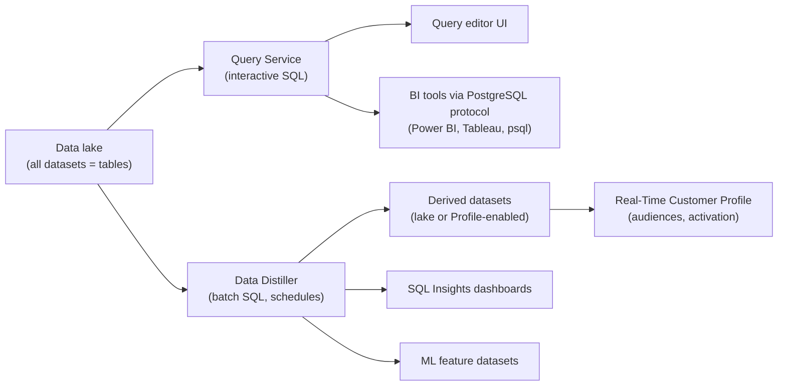

# Chapter 9: Query Service and Data Distiller

**Goal of this chapter:** you can explore and validate any AEP data with SQL, query nested XDM fields and arrays, build derived datasets (including Profile-enabled ones), schedule queries, and connect BI tools.

---

## 1. In plain words

**Query Service** lets you run **SQL** on the data lake: every dataset is a table. It is used to explore data, check quality, validate audiences and answer ad-hoc questions.

**Data Distiller** is the licensed add-on that turns SQL into **data pipelines**: long-running batch queries (up to 24 hours), `CREATE TABLE AS SELECT`/`INSERT INTO` to write **derived datasets**, scheduling, monitoring, SQL-based dashboards (SQL Insights), ML feature preparation and SQL-defined audiences.

## 2. Why it matters on a project

- **Day-to-day validation**: "did yesterday's file load correctly?", "how many profiles have a loyalty ID?"
- **Data quality**: find placeholder identities, nulls, duplicates before they hit Profile.
- **Derived data**: compute RFM scores, propensity features, aggregates and feed them back into Profile.
- **Reporting** without moving data out (BI tools connect directly).

## 3. How it fits



## 4. Interactive vs batch queries

| | Interactive (Query Service) | Batch (Data Distiller) |
| --- | --- | --- |
| Use | Exploration, validation, BI | Pipelines, derived datasets, schedules |
| Run time | Short (interactive time limits) | Up to 24 hours |
| Output | Result rows in UI/client | New or appended datasets (`CREATE TABLE AS`, `INSERT INTO`) |
| Licence | Included with apps (limited) | Data Distiller add-on (compute hours) |

## 5. SQL you will use every week

Tables are named after datasets (shown on each dataset page). XDM nested fields use **dot notation**; your custom fields sit under `_<tenantId>`.

```sql
-- List tables and inspect one
SHOW TABLES;
SELECT * FROM acme_web_events LIMIT 10;

-- Nested and custom fields
SELECT _acmeretail.loyalty.tier AS tier, COUNT(*) AS members
FROM acme_loyalty_members
GROUP BY tier;

-- Identities inside identityMap
SELECT identityMap['ECID'][0].id AS ecid, eventType, timestamp
FROM acme_web_events
WHERE timestamp >= date_sub(current_date, 1);

-- Arrays: one row per product in each event
SELECT p.SKU, p.name, SUM(p.priceTotal) AS revenue
FROM acme_web_events
LATERAL VIEW explode(productListItems) AS p
WHERE eventType = 'commerce.purchases'
GROUP BY p.SKU, p.name
ORDER BY revenue DESC;
```

More scripts: [`code/query-service`](../code/query-service) (exploration, data quality, identity health, sessionization, derived datasets).

## 6. Adobe-defined functions (behavioural analytics in SQL)

Adobe adds window functions for web analytics patterns:

| Function | Purpose |
| --- | --- |
| `SESS_TIMEOUT(timestamp, seconds)` | Build sessions from events with an inactivity timeout |
| `ATTRIBUTION_FIRST_TOUCH` / `ATTRIBUTION_LAST_TOUCH` | Marketing attribution |
| `PREVIOUS` / `NEXT` | Previous/next value (e.g. previous page) |
| `TIME_BETWEEN_PREVIOUS_MATCH` / `TIME_BETWEEN_NEXT_MATCH` | Time between events |

```sql
SELECT ecid, timestamp,
       SESS_TIMEOUT(timestamp, 60 * 30)
         OVER (PARTITION BY ecid ORDER BY timestamp
               ROWS BETWEEN UNBOUNDED PRECEDING AND CURRENT ROW) AS session
FROM (SELECT identityMap['ECID'][0].id AS ecid, timestamp FROM acme_web_events)
LIMIT 100;
```

## 7. Derived datasets (Data Distiller)

Pattern: compute something with SQL, write it into a dataset, optionally enable it for Profile so audiences can use it.

```sql
-- 1) Create a derived dataset (first run)
CREATE TABLE IF NOT EXISTS acme_customer_rfm AS
SELECT crm_id, recency_days, frequency_12m, monetary_12m
FROM ( ...aggregation over purchase events... );

-- 2) Append on later runs
INSERT INTO acme_customer_rfm
SELECT ... ;
```

For a **Profile-enabled** derived dataset, create it on an XDM schema with an identity and the Profile label (the docs show `CREATE TABLE ... WITH (schema='<schema title>', label='PROFILE') AS (SELECT ...)`), and make sure the selected columns follow the schema structure. See [Create derived datasets with SQL](https://experienceleague.adobe.com/en/docs/experience-platform/query/data-distiller/derived-datasets/create-derived-datasets-with-sql).

**Scheduling:** save the query as a template, then **Schedule** it in the UI (or via the API with `ctasParameters`). In a scheduled query you don't write `CREATE TABLE AS`/`INSERT INTO` yourself; you pick the output dataset in the schedule.

## 8. Connecting BI tools and psql

1. **Queries → Credentials**: generate expiring or **non-expiring** credentials (non-expiring for service accounts/BI).
2. Use host, port, database (`<sandbox>:all`), user and password in Power BI, Tableau, Looker or `psql`.
3. Keep BI queries efficient (filter by date; aggregate) and prefer derived summary datasets for dashboards.

## 9. Query Service API (automation)

```http
POST /data/foundation/query/queries
{ "dbName": "<sandbox>:all", "sql": "SELECT COUNT(*) FROM acme_web_events", "name": "daily-count" }

GET  /data/foundation/query/queries/<QUERY_ID>        # state: SUBMITTED, IN_PROGRESS, SUCCESS, FAILED
```

The API runs queries and reports their state; to keep results, write them to a dataset (CTAS) or use a PostgreSQL client. Script: [`code/api/query_job.py`](../code/api/query_job.py).

## 10. Common mistakes

| Mistake | Better |
| --- | --- |
| `SELECT *` on huge event tables without date filters | Always filter on `timestamp` |
| Treating lake counts as profile counts | The lake has rows per record; Profile merges by identity |
| Scheduled queries containing CTAS | Choose the output dataset in the schedule |
| Writing Profile-enabled data without an identity | Use an XDM schema with a primary identity |
| BI dashboards querying raw events live | Pre-aggregate with Data Distiller |

## 11. Architect tips

- Create a **standard validation pack** of SQL (row counts, null checks, identity quality, freshness) run after every load.
- Use Data Distiller for **feature engineering** (RFM, propensity inputs) and feed results back as profile attributes.
- Track **compute hours** (Data Distiller licence) when you design schedules.

## 12. Official docs and videos

- [Query Service overview](https://experienceleague.adobe.com/en/docs/experience-platform/query/home)
- [Query editor UI guide](https://experienceleague.adobe.com/en/docs/experience-platform/query/ui/user-guide)
- [Query schedules](https://experienceleague.adobe.com/en/docs/experience-platform/query/ui/query-schedules)
- [Create derived datasets with SQL](https://experienceleague.adobe.com/en/docs/experience-platform/query/data-distiller/derived-datasets/create-derived-datasets-with-sql)
- [SQL Insights](https://experienceleague.adobe.com/en/docs/experience-platform/query/data-distiller/sql-insights/overview)
- [Feature engineering for ML](https://experienceleague.adobe.com/en/docs/experience-platform/query/data-distiller/ml-feature-pipelines/feature-engineering)
- [Top tips for Data Distiller (Summit session)](https://experienceleague.adobe.com/en/docs/experience-platform/query/data-distiller/top-tips-to-maximize-value)
- [Query Service and Data Distiller FAQ](https://experienceleague.adobe.com/en/docs/experience-platform/query/troubleshooting-guide)

## 13. Check yourself

1. Difference between Query Service and Data Distiller?
2. How do you query one row per product from `productListItems`?
3. Why can a lake count differ from a profile count?
4. How do you make a SQL result usable in audiences?

<details>
<summary>Answers</summary>

1. Query Service is interactive SQL on the lake; Data Distiller adds batch queries, derived datasets, scheduling and more (licensed).
2. `LATERAL VIEW explode(productListItems) AS p` and select `p.SKU`, etc.
3. The lake counts rows/records; profiles merge records across datasets and identities.
4. Write it to a Profile-enabled derived dataset (XDM schema + identity + Profile label), then build audiences on it.
</details>

---

Previous: [Chapter 8](08-audiences-segmentation.md) · Next: [Chapter 10: Destinations and activation](10-destinations-activation.md)
