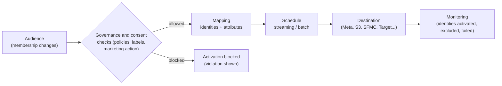

# Chapter 10: Destinations and activation

**Goal of this chapter:** you can activate audiences to advertising, email, storage and personalization destinations, map identities and attributes correctly, respect consent and governance, and monitor activation.

---

## 1. In plain words

A **destination** is a connection from AEP to an outside system (or to Adobe apps) where audiences or data are sent. **Activation** is the act of sending them: "send the *Gold members UK* audience to Meta every time it changes" or "export a daily file of high-value customers with these 10 attributes to S3".

## 2. Why it matters on a project

Activation is where business value is realized (better ad targeting, suppression, personalized email, call-centre prioritization). It is also where **privacy risk** is highest, because data leaves AEP. Governance and consent checks happen here.

## 3. Destination families

| Family | Examples | What is sent |
| --- | --- | --- |
| **Advertising** | Google (Customer Match, DV360), Meta, LinkedIn, TikTok, Snapchat, The Trade Desk, Amazon Ads, Microsoft Advertising | Audience membership with identities (usually hashed email/phone, mobile ad IDs) |
| **Email marketing / CRM** | Salesforce Marketing Cloud, Braze, Oracle, Marketo, Salesforce CRM, Microsoft Dynamics | Audience membership and profile attributes |
| **Cloud storage / files** | Amazon S3, Azure Blob, Google Cloud Storage, SFTP, Data Landing Zone | Files (CSV, JSON, Parquet) with selected attributes and identities |
| **Streaming APIs** | HTTP API destination, partner APIs | Real-time audience changes as JSON |
| **Personalization** | Adobe Target, custom personalization (edge) | Audiences/attributes for same-page or next-page personalization |
| **Dataset export** | Cloud storage | Raw datasets (not audiences) to the client's lake/warehouse |
| **Custom / partner** | Built with **Destination SDK** | Whatever the integration defines |

Two delivery styles:

- **Streaming**: changes (enter/exit) sent within minutes.
- **Batch (file-based)**: files on a schedule (e.g. daily), full or incremental.

## 4. How activation works

## 5. Activating an audience: step by step (UI)

1. **Connections → Destinations → Catalog**: pick the destination → **Set up** (authenticate: OAuth to the ad account, or storage credentials).
2. Fill **destination details** (name, account ID, region) and choose the **marketing action(s)** (e.g. "Email targeting", "Cross-site targeting"): these drive governance checks.
3. **Activate audiences**: select audiences.
4. **Scheduling**: streaming destinations start immediately; for file destinations choose full or incremental export, frequency, time, file name pattern.
5. **Mapping**:
   - **Identities**: e.g. hashed email (`Email_LC_SHA256`) → destination's email field; or let AEP hash raw email (where the destination supports "apply transformation").
   - **Attributes** (file/CRM destinations): choose profile fields to export.
   - **Mandatory attributes / deduplication keys** for file exports.
6. **Review**: AEP evaluates **data usage policies** and **consent**; violations block activation with an explanation.
7. **Finish** and monitor.

## 6. Identity mapping rules of thumb

| Destination type | Identity typically mapped |
| --- | --- |
| Social and search ads | Hashed email (SHA-256, normalized), hashed phone, mobile ad IDs |
| Programmatic (DSPs) | Partner IDs, hashed email (via ID solutions), mobile ad IDs |
| Email platforms | Email (raw) or the platform's subscriber key / CRM ID |
| CRM | CRM ID |
| Files | Whatever the receiving team needs (CRM ID + selected attributes) |

Profiles without the mapped identity are **not exported**, which is why destination counts are often lower than audience counts.

## 7. Governance and consent at activation

- **Data usage labels** on fields/datasets (e.g. `C2` "no third-party export", `C4` "no on-site ads") + **policies** + the destination's **marketing actions** → AEP blocks activations that would violate a policy (Chapter 14).
- **Consent**: with consent policies (e.g. "don't use for email unless consents.marketing.email = y"), non-consented profiles are filtered out automatically.
- Always involve the privacy owner when adding a new destination type.

## 8. Monitoring

- **Destinations → Browse → destination → dataflow runs**: identities activated, excluded (e.g. no identity, consent), failed; error details.
- **Monitoring dashboard → Destinations**: activation health across destinations.
- **Alerts**: subscribe to activation failures.
- Partner side: audience sizes in the ad platform are often smaller again because of the partner's own **match rate**.

Script: [`code/api/destination_flows.py`](../code/api/destination_flows.py) lists destination dataflows and recent run status via the Flow Service API.

## 9. Destination SDK

When no catalog destination exists, **Destination SDK** lets partners and customers configure a **streaming (REST API)** or **file-based** destination through configuration (server spec, authentication, message template, audience metadata), without writing a service. Use it for internal systems or regional ad platforms. Docs: [Destination SDK overview](https://experienceleague.adobe.com/en/docs/experience-platform/destinations/destination-sdk/overview).

## 10. Common mistakes

| Mistake | Better |
| --- | --- |
| Mapping raw email to an ad destination that expects hashed | Use hashed identity or the hashing transformation |
| Exporting many attributes "just in case" | Export only what the use case needs (data minimization) |
| No marketing action on the destination | Set marketing actions so governance works |
| Expecting audience count = destination count | Explain identity coverage, consent filters and partner match rates |
| Full daily file exports of millions of rows when incremental works | Incremental exports |

## 11. Architect tips

- Keep a **destination mapping** document: destination, account, marketing actions, identities, attributes, schedule, owner.
- Create **suppression** activations too (e.g. send "existing customers" to ad platforms for exclusion).
- Use **dataset export** to give the data warehouse a copy of AEP data instead of building custom extracts.
- Measure: plan how each activation's impact will be measured (holdouts, CJA, partner reports).

## 12. Official docs and videos

- [Destinations overview](https://experienceleague.adobe.com/en/docs/experience-platform/destinations/home)
- [Destinations catalog](https://experienceleague.adobe.com/en/docs/experience-platform/destinations/catalog/overview)
- [Activate audiences to streaming destinations](https://experienceleague.adobe.com/en/docs/experience-platform/destinations/ui/activate/activate-segment-streaming-destinations)
- [Activate audiences to file-based destinations](https://experienceleague.adobe.com/en/docs/experience-platform/destinations/ui/activate/activate-batch-profile-destinations)
- [Monitor dataflows for destinations](https://experienceleague.adobe.com/en/docs/experience-platform/dataflows/ui/monitor-destinations)
- [Destination SDK overview](https://experienceleague.adobe.com/en/docs/experience-platform/destinations/destination-sdk/overview)
- [Data governance at activation](https://experienceleague.adobe.com/en/docs/experience-platform/data-governance/enforcement/auto-enforcement)

## 13. Check yourself

1. Why must you set marketing actions on a destination?
2. An audience has 1,000,000 profiles; Meta receives 600,000. Give three reasons.
3. Streaming vs file-based destinations: one use case each.
4. When would you use Destination SDK?

Answers

1. Governance policies compare data usage labels with the destination's marketing actions to allow or block activation.
2. Profiles without the mapped identity (hashed email), consent filtering, governance exclusions (and later Meta's own match rate).
3. Streaming: suppress recent purchasers in ads within minutes; file-based: daily export to the data warehouse or call-centre list.
4. When there is no catalog destination for the target system (internal API, regional ad platform).

---

Previous: [Chapter 9](09-query-service-data-distiller.md) · Next: [Chapter 11: Real-Time CDP in depth](11-real-time-cdp.md)
