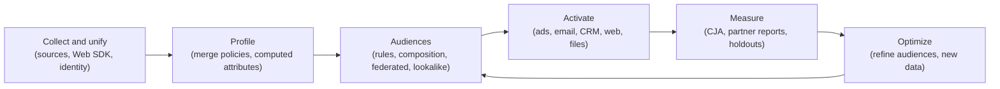
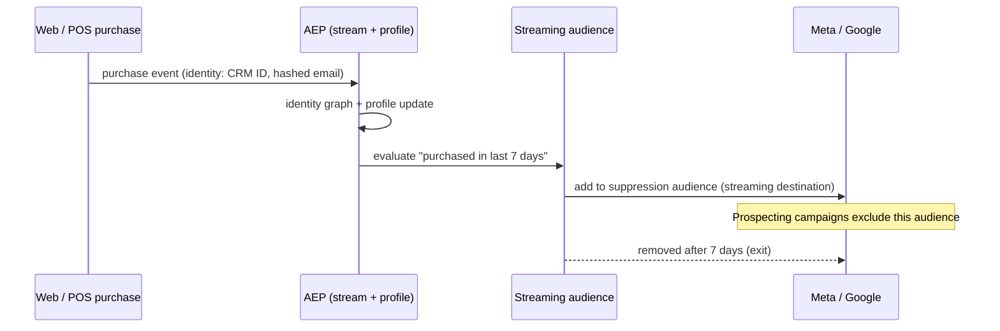

# Chapter 11: Real-Time CDP in depth

**Goal of this chapter:** you can explain what Real-Time CDP adds on top of the platform, know the editions and packages, design the most common CDP use cases end to end, and support B2B projects.

---

## 1. In plain words

**Real-Time Customer Data Platform (Real-Time CDP)** is the AEP application that marketing and data teams use to **build profiles, create audiences and activate them** to channels. Practically, it is the bundle of everything in Chapters 3-10 (schemas, identity, profile, audiences, destinations, governance) packaged as a product, plus CDP-specific features.

## 2. Editions and packages

| Edition | For | Adds |
| --- | --- | --- |
| **B2C** | Consumer brands | Person profiles, audiences, destinations |
| **B2B** | Account-based marketing | B2B classes (Account, Opportunity, Campaign, Marketing List...), account and person identity resolution, account hierarchies, account audiences, Marketo Engage integration |
| **B2P** | Both B2C and B2B in one CDP | Person and account capabilities together |

Each edition is sold as **Prime** or **Ultimate**. Packages differ in capabilities and limits (for example AI-driven features, number of sandboxes, profile and data volumes, add-ons). The exact matrix changes and depends on the contract, so on every project **ask for the licensed edition, package, add-ons and volumes** before designing. Optional add-ons include **Data Distiller**, **Privacy & Security Shield** or **Healthcare Shield**, **Collaboration** (a data clean room for partner audiences, limited availability by region) and **Federated Audience Composition**.

## 3. The CDP operating loop

## 4. The ten most common Real-Time CDP use cases

| # | Use case | Data needed | Audience type | Activation | KPI |
| --- | --- | --- | --- | --- | --- |
| 1 | **Paid media suppression** of existing customers / recent buyers | CRM customers, purchases | Streaming or batch | Google, Meta, DSPs | Media cost saved |
| 2 | **Retargeting** of browse/cart abandoners | Web events, cart events | Streaming | Ad platforms, email | Conversion rate |
| 3 | **Lookalike / prospecting** from best customers | Purchase value, loyalty | Batch | Ad platforms (+ lookalike features) | Cost per acquisition |
| 4 | **Cart abandonment email/push** | Web/app events, consent | Streaming | AJO or email platform | Recovered revenue |
| 5 | **On-site personalization** for known segments | Profile attributes, recent events | Edge | Target / AJO web | Click-through, conversion |
| 6 | **Loyalty tier upgrade** communications | Loyalty points/tier changes | Streaming | AJO, CRM | Engagement |
| 7 | **Churn prevention** | Activity recency, service events, propensity scores | Batch | Email, call centre file | Retention |
| 8 | **Next best offer** in owned channels | Purchases, product affinity | Batch/streaming | AJO decisioning, Target | Offer acceptance |
| 9 | **Call-centre prioritization** | Profile value, open cases | Batch | CRM / file export | Handle time, NPS |
| 10 | **Data sharing with the warehouse** | All AEP datasets | — | Dataset export to cloud storage | Time-to-insight |

## 5. Designing a use case end to end: example

**Use case:** "Suppress customers who purchased in the last 7 days from prospecting ads, within 1 hour of purchase."

Design checklist for the example:

- [ ] Purchase events streamed (Web SDK for online, HTTP API for POS) with CRM ID and email.
- [ ] Hashed email available for the ad destinations; consent for advertising captured.
- [ ] Streaming-eligible audience definition (single event type in a time window).
- [ ] Destination marketing action "Cross-site targeting"; policies allow it.
- [ ] Measurement: media spend on existing customers before vs after.

## 6. Real-Time CDP B2B essentials

- **Classes**: XDM Business Account, Business Opportunity, Business Campaign, Business Marketing List, Person-Account and Person-Opportunity relationships.
- **Identity**: people (email, CRM contact ID) and accounts (CRM account ID); account hierarchies.
- **Sources**: Salesforce, Microsoft Dynamics, Marketo Engage (people, activities, accounts, opportunities).
- **Account audiences**: "accounts in industry X with an open opportunity > $100k where 3+ contacts visited the pricing page"; activate accounts and their people to LinkedIn, Marketo, Salesforce.
- Docs: [Real-Time CDP B2B Edition overview](https://experienceleague.adobe.com/en/docs/experience-platform/rtcdp/intro/rtcdpb2b-intro/b2b-overview)

## 7. Delivery plan that works

1. **Foundation sprint(s)**: sandboxes, access, schemas, identity strategy, first sources, Web SDK.
2. **Use case 1 end to end** (usually suppression or abandonment): data → profile → audience → destination → measurement.
3. **Hardening**: monitoring, alerts, governance labels and policies, runbooks.
4. **Scale**: next use cases from the catalogue, reusing schemas, audiences and destinations.
5. **Optimize**: computed attributes, AI features, AJO/CJA expansion.

## 8. Common mistakes

| Mistake | Better |
| --- | --- |
| "Load everything, then think about use cases" | Use-case-driven releases |
| Not checking edition/package before designing | Confirm licensed features and volumes first |
| No measurement plan | Define KPI and method (holdout, control group, A/B) up front |
| Every team builds its own audiences | Central audience inventory and base audiences |
| Ignoring partner match rates | Explain and track expected match rates per destination |

## 9. Architect tips

- Keep a **use-case canvas** per use case: goal, KPI, data, identity, audience logic and type, merge policy, destination, consent, owner, measurement.
- Prefer **suppression and abandonment** as first use cases: quick, measurable value.
- Watch licence metrics (addressable audience, profile richness) in the **license usage dashboard** monthly.

## 10. Official docs and videos

- [Real-Time CDP overview](https://experienceleague.adobe.com/en/docs/experience-platform/rtcdp/intro/rtcdp-intro/overview)
- [Real-Time CDP B2B overview](https://experienceleague.adobe.com/en/docs/experience-platform/rtcdp/intro/rtcdpb2b-intro/b2b-overview)
- [Adobe Real-Time CDP product page](https://business.adobe.com/products/real-time-customer-data-platform/rtcdp.html) · [Feature comparison](https://business.adobe.com/products/real-time-customer-data-platform/compare.html)
- [Video playlist: Get started with Real-Time CDP for marketers](https://experienceleague.adobe.com/en/playlists/real-time-customer-data-platform-get-started-for-marketers)
- [Licence entitlement best practices](https://experienceleague.adobe.com/en/docs/experience-platform/landing/license/data-management-best-practices)

## 11. Check yourself

1. What does B2B edition add over B2C?
2. Why ask for the package (Prime/Ultimate) and add-ons on day one?
3. Design the data, audience type and destination for "retarget cart abandoners within 1 hour on Meta".
4. Name two good first use cases and why.

Answers

1. B2B classes (accounts, opportunities...), account/person identity, account hierarchies, account audiences, B2B sources such as Marketo Engage.
2. Features and limits depend on them; designs must fit what's licensed.
3. Web cart and purchase events (Web SDK) with ECID + login IDs and hashed email; streaming audience "added to cart in last hour and no purchase"; Meta streaming destination with hashed email and consent.
4. Paid media suppression (saves money fast, simple data) and cart abandonment (clear revenue impact).

---

Previous: [Chapter 10](10-destinations-activation.md) · Next: [Chapter 12: Adobe Journey Optimizer](12-journey-optimizer.md)
