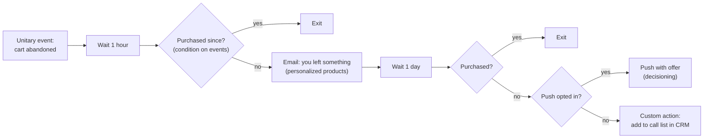

# Chapter 12: Adobe Journey Optimizer (AJO)

**Goal of this chapter:** you understand journeys, campaigns, events, channels, content personalization, custom actions and decisioning; you can design and test a journey; and you know AJO's main limits.

---

## 1. In plain words

**Journey Optimizer** is the AEP application that **talks to customers**: it sends the right message (email, push, SMS, in-app, web, code-based experiences in apps/sites, and more) at the right time, based on what the customer does and who they are in AEP.

It has two ways to send:

- **Journeys**: multi-step, real-time flows that react to each person ("when someone abandons a cart, wait 1 hour, if no purchase send email, then push after a day").
- **Campaigns**: one-off or recurring sends to an audience ("this Friday's newsletter to all opted-in gold members"), or API-triggered single messages from another system.

## 2. Why it matters on a project

AJO is often the main business reason to buy AEP: it turns profiles and audiences into revenue-generating communications. It depends on everything before it: clean events, identities, consent, audiences.

## 3. Building blocks

| Block | What it is |
| --- | --- |
| **Journey** | Canvas with entry, waits, conditions, actions (messages, custom actions), exits |
| **Campaign** | Scheduled/recurring send to an audience, or API-triggered |
| **Unitary event** | An event about one person that starts or moves a journey (e.g. cart abandoned) |
| **Business event** | An event affecting many profiles at once (e.g. product back in stock) |
| **Audience entry** | Read audience (batch on a schedule) or audience qualification (person enters/exits a streaming audience) |
| **Channel configurations (surfaces)** | Sender settings per channel: email domains/IPs, push apps, SMS providers, web/app locations |
| **Content** | Email designer, templates, fragments, personalization editor, assets (including AEM Assets) |
| **Data sources** | External data looked up during a journey (e.g. weather, stock) |
| **Custom actions** | Calls to external systems from a journey (REST APIs: CRM, loyalty, messaging partners) |
| **Decisioning** | Choose the best offer/content item for each person with rules and ranking |
| **Experimentation** | A/B tests and multi-armed bandit on content and paths |
| **Frequency/business rules** | Limit how many messages a person gets per channel/period |

## 4. Journey types (how a journey starts)

| Type | Starts when | Example |
| --- | --- | --- |
| **Unitary event** | A specific event for one person arrives | Order placed → confirmation + cross-sell |
| **Audience qualification** | A person enters or exits a **streaming** audience | Became gold member → welcome to gold |
| **Read audience** | On a schedule, for all members of an audience | Weekly digest to active subscribers |
| **Business event** | An event affecting many people | Item back in stock → notify people who wanted it |

Note from Adobe's 2026 documentation: using a **batch-evaluated** audience in an audience qualification journey is deprecated and blocked from August 2026; use streaming audiences for qualification journeys.

## 5. Example journey: cart abandonment



## 6. Events: how data reaches a journey

1. **Configure the event** (Administration → Configurations → Events): choose the schema and fields, the identity (namespace) and, for rule-based events, the condition (e.g. `eventType = "commerce.productListAdds"`).
2. **Send the event** to AEP through streaming (Web SDK, Mobile SDK, HTTP API). For events configured with an event ID, the payload must carry the journey event ID in `_experience.campaign.orchestration.eventID` (sample: [`code/journey-optimizer/unitary-event-cart-abandoned.json`](../code/journey-optimizer/unitary-event-cart-abandoned.json)).
3. **Test** the journey in **test mode** with test profiles and simulated events.

## 7. Personalizing content

The personalization editor uses expression syntax based on Handlebars:

```text
Hi {{profile.person.name.firstName}},


  As a Gold member you get free express delivery.

  Free delivery on orders over £50.


You left {{context.journey.events.<EVENT_ID>.productListItems.size()}} item(s) in your basket.
```

Sources of personalization data: profile attributes, journey event data (`context.journey.events...`), audience membership, computed attributes, data source lookups, offers from decisioning. More examples: [`code/journey-optimizer/personalization-examples.md`](../code/journey-optimizer/personalization-examples.md).

## 8. Custom actions

A custom action calls an external REST API from a journey, e.g. "create a task in the CRM" or "send a WhatsApp message through a provider". You configure: URL, method, headers/authentication, payload with **constant** and **variable** fields (mapped from profile/event data in the journey). Example configuration: [`code/journey-optimizer/custom-action-crm-task.json`](../code/journey-optimizer/custom-action-crm-task.json).

Design rules: make the endpoint idempotent, handle timeouts (the journey can branch on errors), respect the endpoint's rate limits (AJO lets you cap calls per second).

## 9. Decisioning (offers)

- Create **offers/decision items** (content + eligibility rules + priority + constraints such as caps).
- Group them in **collections**; create a **decision policy/selection strategy** with ranking (priority, formula or AI model).
- Use the decision in a message (email, push, web, code-based) so each person sees the best eligible item.
- Typical uses: next best offer, banner on home page, product recommendation slots.

## 10. Guardrails to know (check the live page)

From Adobe's AJO guardrails and 2026 notes:

- Unitary event and audience qualification journeys share an organization-level throughput limit (5,000 events/second); read audience journeys support higher throughput per sandbox.
- Re-entrance: by default a profile can't re-enter a unitary journey for 5 minutes.
- Events that start or enter a journey are limited to 64 KB.
- Waits, number of activities, journey duration and message sizes have their own limits.

[Journey Optimizer guardrails and limitations](https://experienceleague.adobe.com/en/docs/journey-optimizer/using/get-started/essentials/guardrails)

## 11. Testing and go-live checklist

- [ ] Channel configurations (email domains, SPF/DKIM/DMARC, push certificates, SMS) set up and warmed (email IP warm-up plan).
- [ ] Consent and subscription preferences respected (channel opt-ins, quiet hours).
- [ ] Test profiles with seed lists; test mode run for each branch.
- [ ] Event payload validated (identity, event ID, required fields).
- [ ] Frequency rules applied; suppression audiences in place.
- [ ] Reporting: journey report, message delivery/opens/clicks; CJA connection for deeper analysis.
- [ ] Rollback plan: stop/close journey; message content versions.

## 12. Common mistakes

| Mistake | Better |
| --- | --- |
| Batch audience in a qualification journey | Streaming audience, or read-audience journey on a schedule |
| Heavy logic in journey conditions | Pre-compute with computed attributes or audiences |
| Sending events without the configured identity | Ensure the event's identity namespace matches the event configuration |
| No frequency capping | Business rules per channel |
| Custom action to a fragile endpoint | Idempotent, rate-limited, monitored endpoints |

## 13. Architect tips

- Use **journeys** for behaviour-driven, multi-step flows; **campaigns** for scheduled broadcasts and API-triggered transactional messages.
- Keep **event taxonomy** shared between Web SDK, AJO and CJA.
- Reuse content from AEM (Experience Fragments, Content Fragments, AEM Assets) where the client already manages content there.
- Plan email deliverability (domains, IP warm-up) early; it takes weeks.

## 14. Official docs and videos

- [Journey Optimizer documentation](https://experienceleague.adobe.com/en/docs/journey-optimizer)
- [Journeys vs campaigns](https://experienceleague.adobe.com/en/docs/journey-optimizer/using/get-started/essentials/journeys-vs-campaigns)
- [Journey types: choose the right one](https://experienceleague.adobe.com/en/docs/journey-optimizer/using/orchestrate-journeys/about-journey-building/journey-types-selection)
- [Work with journey events](https://experienceleague.adobe.com/en/docs/journey-optimizer/using/configure-journeys/events-journeys/about-events)
- [Additional steps to send events to a journey](https://experienceleague.adobe.com/en/docs/journey-optimizer/using/configure-journeys/events-journeys/additional-steps-to-send-events-to-journey)
- [Guardrails and limitations](https://experienceleague.adobe.com/en/docs/journey-optimizer/using/get-started/essentials/guardrails)
- [Release notes 2026](https://experienceleague.adobe.com/en/docs/journey-optimizer/using/whats-new/previous-rn-new/release-notes-2026)
- [Get started with data management in AJO](https://experienceleague.adobe.com/en/docs/journey-optimizer/using/data-management/gs-data)
- [Journey Optimizer tutorials and videos](https://experienceleague.adobe.com/en/docs/journey-optimizer-learn)

## 15. Check yourself

1. Journey or campaign: "monthly newsletter"? "Welcome series after sign-up"?
2. Which four ways can a journey start?
3. Where must the event ID be in a unitary event payload?
4. How would you call a CRM from a journey?
5. Name two AJO guardrails.

<details>
<summary>Answers</summary>

1. Newsletter → campaign; welcome series → journey (unitary event or audience qualification).
2. Unitary event, audience qualification, read audience, business event.
3. `_experience.campaign.orchestration.eventID`.
4. A custom action (REST API call with mapped parameters).
5. Shared 5,000 events/second for unitary and qualification journeys; 5-minute default re-entrance wait; 64 KB event size.
</details>

---

Previous: [Chapter 11](11-real-time-cdp.md) · Next: [Chapter 13: Customer Journey Analytics](13-customer-journey-analytics.md)
