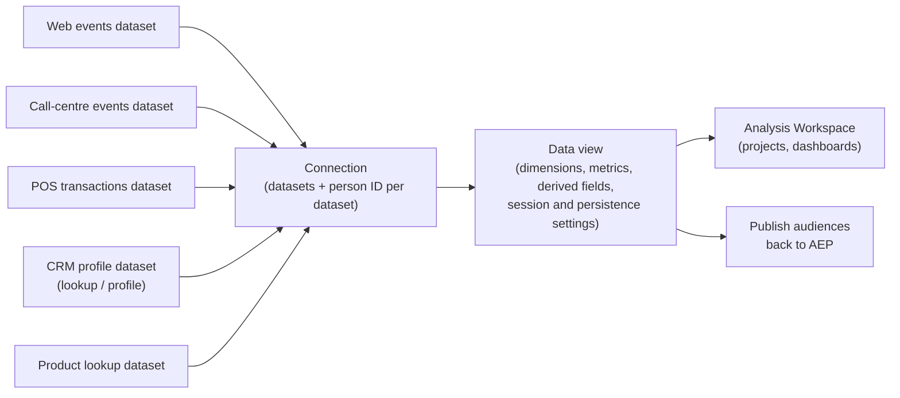

# Chapter 13: Customer Journey Analytics (CJA)

**Goal of this chapter:** you understand how CJA analyses AEP data, can set up a connection and a data view, choose a stitching method, and know how CJA differs from Adobe Analytics.

---

## 1. In plain words

**Customer Journey Analytics** is Adobe's analytics application built on AEP. It reads **AEP datasets** (web, app, call centre, POS, CRM, email...) and lets analysts explore the **whole journey across channels** in **Analysis Workspace**: freeform tables, flows, fallouts, cohorts, attribution.

Where Adobe Analytics analyses mainly digital data collected into report suites, CJA analyses any data you bring into AEP, joined by a person ID.

## 2. Why it matters on a project

- Measures the impact of CDP and AJO use cases.
- Answers cross-channel questions: "do customers who call support after browsing the returns page churn more?"
- Often replaces or extends Adobe Analytics in AEP programs, so web data design (Chapter 6) must serve both activation and analytics.

## 3. How CJA is set up

| Object | What it is |
| --- | --- |
| **Connection** | Which AEP datasets CJA reads, the **person ID** used in each (must represent the same person across datasets), and backfill/streaming settings |
| **Data view** | The "lens" on a connection: which fields become dimensions/metrics, their names and formats, attribution and persistence, session timeout, filters, **derived fields** (calculated at report time) |
| **Analysis Workspace** | The reporting UI (same family as in Adobe Analytics) |
| **Stitching** | Re-keys anonymous events (ECID) to the person ID so pre-login behaviour joins the person |

## 4. Stitching (joining anonymous and known activity)

| Method | How | Package (per Adobe docs) |
| --- | --- | --- |
| **Field-based** | Uses two fields in the event dataset: a persistent ID (ECID/cookie) and a person ID present on some rows (after login) | Select package or higher |
| **Graph-based** | Uses the AEP **identity graph** to find the person ID for a persistent ID | Prime package or higher |

Both run **live stitching** (as events arrive) and **replay stitching** (re-processing a lookback window once new identity links are known). Stitching is case-sensitive, so normalize IDs. Docs: [Stitching overview](https://experienceleague.adobe.com/en/docs/analytics-platform/using/stitching/overview).

## 5. Setting up: step by step

1. Ensure datasets have a shared **person ID** field (e.g. CRM ID) or plan stitching.
2. **Data management → Connections → Create**: choose sandbox, add datasets, pick the person ID per dataset, enable streaming/backfill, set lookup datasets (e.g. product catalogue keyed by SKU).
3. **Data views → Create**: add components (dimensions/metrics), set session settings, create derived fields (e.g. clean marketing channel), set persistence (e.g. "last touch, expire after 30 days").
4. **Workspace**: build a first project (traffic, conversion funnel, channel attribution) and validate numbers against source systems.
5. Share projects/dashboards and set up scheduled reports or alerts.

## 6. CJA vs Adobe Analytics (short)

| | Adobe Analytics | CJA |
| --- | --- | --- |
| Data | Report suites (mainly digital) | Any AEP datasets (online + offline) |
| Schema | Props/eVars/events | XDM fields, unlimited dimensions |
| Changes | Processing rules, VISTA; mostly forward-only | Data views change reporting retroactively |
| Person-level | Visitor (device) focused, CDA for people | Person ID native, stitching |
| Collection | AppMeasurement or Web SDK | Web SDK / any AEP ingestion |

Migration paths: dual collection with the Web SDK (Analytics + AEP from one call), the Analytics source connector to bring report-suite data into AEP, and rebuilding key reports as CJA data views.

## 7. Common mistakes

| Mistake | Better |
| --- | --- |
| Different person IDs per dataset in one connection | Agree one person ID; normalize formats |
| Copying Analytics eVar logic 1:1 | Rethink with XDM fields and derived fields |
| No validation of numbers | Compare key metrics with source systems in the first weeks |
| Huge connections "just in case" | Add datasets per question; watch licence row counts |

## 8. Architect tips

- Design web/app XDM once for **AJO, CDP and CJA** together (shared event taxonomy).
- Use **lookup datasets** for products, stores and campaigns instead of copying attributes onto every event.
- Use CJA to **measure CDP/AJO use cases** with holdout groups and journey-level analysis.

## 9. Official docs and videos

- [Customer Journey Analytics documentation](https://experienceleague.adobe.com/en/docs/analytics-platform)
- [Stitching overview](https://experienceleague.adobe.com/en/docs/analytics-platform/using/stitching/overview) · [Field-based](https://experienceleague.adobe.com/en/docs/analytics-platform/using/stitching/fbs) · [Graph-based](https://experienceleague.adobe.com/en/docs/analytics-platform/using/stitching/gbs) · [Validate stitching](https://experienceleague.adobe.com/en/docs/analytics-platform/using/stitching/validate)
- [CJA guardrails](https://experienceleague.adobe.com/en/docs/analytics-platform/using/technotes/guardrails)
- [Query Service and dataset export for CJA](https://experienceleague.adobe.com/en/docs/analytics-platform/using/cja-usecases/data-export/queryservice-export-datasets)
- [Understanding your data journey from AEP to CJA](https://experienceleague.adobe.com/en/perspectives/understanding-your-data-journey-from-aep-to-cja)
- [CJA tutorials and videos](https://experienceleague.adobe.com/en/docs/analytics-platform-learn)

## 10. Check yourself

1. What is the difference between a connection and a data view?
2. Field-based vs graph-based stitching?
3. Why can a data view change historical reports?
4. Name two ways to move from Adobe Analytics to CJA.

Answers

1. A connection picks datasets and the person ID; a data view defines how fields appear and behave in reports.
2. Field-based uses persistent and person ID fields in the dataset; graph-based uses the AEP identity graph.
3. CJA applies data view settings at report time on the stored data.
4. Web SDK dual collection; Analytics source connector (and rebuild reports in data views).

---

Previous: [Chapter 12](12-journey-optimizer.md) · Next: [Chapter 14: Governance, privacy and security](14-governance-privacy-security.md)
