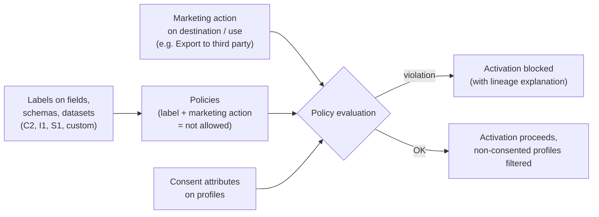

# Chapter 14: Data governance, privacy and security

**Goal of this chapter:** you can label data, define and enforce usage policies, handle consent, process privacy requests (GDPR/CCPA), control who sees what, and explain AEP's security options.

---

## 1. In plain words

AEP holds personal data, so you must control **what data may be used for what purpose**, **who may see it**, and **how people's rights are respected**. AEP gives you four tools:

1. **Data usage labels + policies** (Data Usage Labeling and Enforcement, "DULE"): tag data and block uses that break rules.
2. **Consent**: store each person's choices and filter activation by them.
3. **Privacy Service and data lifecycle**: access and delete requests; data expiry and record deletion.
4. **Access control and security**: roles, attribute-based access, encryption, customer-managed keys, audit logs.

## 2. Why it matters on a project

A single wrong activation (e.g. health data to an ad platform, or emailing someone who opted out) can be a legal incident. Governance must be designed in from the start, not bolted on before go-live.

## 3. How enforcement works



## 4. Labels

| Family | Examples | Meaning |
| --- | --- | --- |
| **Contract (C)** | C1 export aggregated/anonymous only, **C2 no export to third party**, C12 no export at all, others | Contractual obligations |
| **Identity (I)** | **I1** directly identifiable (name, email), **I2** indirectly identifiable (device IDs) | Identifiability |
| **Sensitive (S)** | **S1** precise location, **S2** broad geofence; PSPD/RHD for permitted sensitive/health data (special handling) | Sensitive data |
| **Custom labels** | Your own (e.g. `EMP` employee data) | Client policies |

Labels can be applied to **schema fields** (inherited by datasets), **datasets**, and are carried to audiences built on them (**data lineage**).

## 5. Policies and marketing actions

- A **policy** = "data with label X must not be used for marketing action Y".
- **Marketing actions** describe uses: *Export to third party*, *Email targeting*, *Cross-site targeting*, *Onsite advertising*, *Data science*, custom actions.
- Adobe provides **core policies** (e.g. the out-of-the-box "3rd party export restriction" ties **C2** to **Export to third party**); you create **custom policies** and **enable** them.
- Enforcement happens automatically when activating audiences to destinations and in other activation flows; violations show which label and dataset caused them.
- Labels are case-sensitive in policy evaluation (`C1` vs `c1`).

## 6. Consent

1. Model consent on the profile with the **Consents and Preferences** field group (collect, marketing per channel, personalization, share) and/or IAB TCF 2.x strings.
2. Collect it from the website via `setConsent` (Chapter 6), from the CMP/preference centre by ingestion, and keep one dataset as the source of truth (use **dataset precedence** in the merge policy so it wins; Chapter 7).
3. Enforce it:
   - in **audiences** with explicit rules (e.g. `consents.marketing.email.val = "y"`), and
   - with **consent policies** that automatically filter non-consented profiles during activation (consent policies and some advanced controls depend on licensed packages/add-ons such as Privacy & Security Shield or Healthcare Shield; check the licence).
4. In AJO, channel preferences and subscription lists apply to each send.

Docs: [Consent processing in AEP](https://experienceleague.adobe.com/en/docs/experience-platform/landing/governance-privacy-security/consent/adobe/overview)

## 7. Privacy requests (GDPR, CCPA and others)

- **Privacy Service** receives **access** (export my data) and **delete** requests and fans them out to Adobe apps (AEP data lake, Profile, Identity, AJO, CJA, Analytics...).
- Submit via the **Privacy Service UI** or **API** (example: [`code/api/privacy_request.py`](../code/api/privacy_request.py)).
- Requests are processed per identity (email, CRM ID...); Profile processes privacy requests without identity stitching, so send all known identities of the person.
- Track job status and keep evidence for the DPO.

```json
{
  "companyContexts": [ { "namespace": "imsOrgID", "value": "<ORG_ID>@AdobeOrg" } ],
  "users": [ { "key": "request-001", "action": ["delete"],
               "userIDs": [ { "namespace": "email", "value": "asha.rao@example.com", "type": "standard" } ] } ],
  "include": ["aepDataLake", "profileService", "identity"],
  "regulation": "gdpr"
}
```

## 8. Data lifecycle

| Need | Tool |
| --- | --- |
| Remove a bad load | Delete the batch |
| Remove all data for specific identities (not a privacy request) | Data lifecycle **record delete** (by licence) |
| Keep events only N days in Profile | **Experience Event expiration** |
| Remove inactive anonymous profiles | **Pseudonymous profile data expiration** |
| Remove a whole dataset after a date | **Dataset expiration** |

## 9. Access control and security

- **Role-based access**: roles per sandbox with permissions (manage schemas, view profiles, activate destinations, query...).
- **Attribute-based access control (ABAC)**: apply labels to fields/audiences and give roles access only to certain labels (e.g. only the privacy team sees `S1` data).
- **Encryption** in transit and at rest by default; **customer-managed keys** (CMK) to control encryption keys (Shield add-ons).
- **Audit logs**: who changed what (schemas, audiences, destinations, policies), exportable.
- **Network/data residency**: data stays in the organization's provisioned region.
- **HIPAA-ready** set-ups with Healthcare Shield where licensed.

## 10. Step by step: governance set-up for a new program

1. Workshop with legal/DPO: list regulations, contracts, sensitive data, consent model.
2. Define **labels** (core + custom) and a **label matrix** per field.
3. Define **policies** and **marketing actions**; enable them in dev, test, then prod.
4. Label schemas/datasets as part of every schema change (Definition of Done).
5. Model and ingest **consent**; build a **global suppression** audience.
6. Configure **roles and ABAC**; least privilege; separate admin roles.
7. Set up **Privacy Service** process (who submits, SLAs, evidence).
8. Configure **retention/expiration** per dataset.
9. Review audit logs and activation violations monthly.

## 11. Common mistakes

| Mistake | Better |
| --- | --- |
| Labelling after go-live | Labels as part of schema design |
| No marketing actions on destinations | Policies can't evaluate without them |
| Consent only in the CMP, not in AEP | Ingest and model consent on the profile |
| Everyone is a product admin | Roles + ABAC + least privilege |
| Privacy requests by one identity only | Send all known identities |

## 12. Official docs and videos

- [Data governance overview](https://experienceleague.adobe.com/en/docs/experience-platform/data-governance/home)
- [Data usage labels glossary](https://experienceleague.adobe.com/en/docs/experience-platform/data-governance/labels/reference)
- [Hands-on: Apply the data governance framework](https://experienceleague.adobe.com/en/docs/platform-learn/getting-started-for-data-architects-and-data-engineers/apply-data-governance-framework)
- [Enforce data usage policies (API)](https://experienceleague.adobe.com/en/docs/experience-platform/data-governance/enforcement/api-enforcement) · [Policy evaluation endpoints](https://experienceleague.adobe.com/en/docs/experience-platform/data-governance/api/evaluation)
- [Manage dataset labels (API)](https://experienceleague.adobe.com/en/docs/experience-platform/data-governance/labels/dataset-api)
- [Consent processing](https://experienceleague.adobe.com/en/docs/experience-platform/landing/governance-privacy-security/consent/adobe/overview)
- [Privacy Service API: getting started](https://experienceleague.adobe.com/en/docs/experience-platform/privacy/api/getting-started)
- [Privacy requests in Profile](https://experienceleague.adobe.com/docs/experience-platform/profile/privacy.html)
- [Attribute-based access control: labels](https://experienceleague.adobe.com/en/docs/experience-platform/access-control/abac/permissions-ui/labels)
- [Video: Data governance framework (Journey Optimizer tutorial)](https://experienceleague.adobe.com/en/docs/journey-optimizer-learn/tutorials/data-governance-and-privacy/data-governance-framework)

## 13. Check yourself

1. What two things does a policy combine?
2. Which label stops export to third parties, and which out-of-the-box policy uses it?
3. How do you make sure consent from the CMP always wins over other sources?
4. Why send all identities with a privacy delete request?
5. What does ABAC add on top of roles?

<details>
<summary>Answers</summary>

1. A data usage label and a marketing action.
2. C2; the "3rd party export restriction" core policy with the Export to Third Party marketing action.
3. Ingest consent into a dedicated dataset and use dataset precedence in the merge policy with that dataset first.
4. Profile processes privacy requests without identity stitching, so every identity must be listed to reach all data.
5. Access restricted by labels on fields/objects (e.g. only some roles see sensitive fields).
</details>

---

Previous: [Chapter 13](13-customer-journey-analytics.md) · Next: [Chapter 15: APIs, automation and DevOps](15-apis-automation-devops.md)
