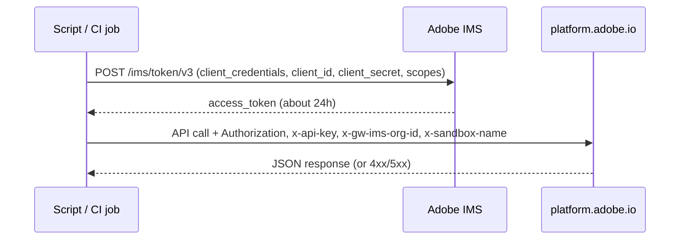
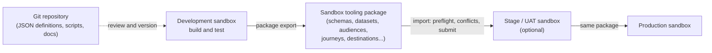

# Chapter 15: APIs, automation and DevOps

**Goal of this chapter:** you can call any Platform API safely, automate repeatable tasks, promote configuration between sandboxes, and run AEP like a well-managed production system (monitoring, alerts, audit).

---

## 1. In plain words

Everything in the AEP UI is backed by REST APIs. Using them lets you **automate** (create schemas, run audits, export settings), **integrate** (other systems call AEP) and **treat configuration like code** (review, version, promote). Around the APIs, DevOps practices keep the platform reliable: sandboxes as environments, promotion packages, monitoring, alerts and audit logs.

## 2. Authentication recap

- Credential type: **OAuth Server-to-Server** in Adobe Developer Console (the older JWT credential type has been retired).
- The credential's technical account needs an **AEP role** for each sandbox it touches.
- Omit `x-sandbox-name` and calls go to the **default** sandbox, which is a classic way to change production by mistake. Always set it explicitly.
- Store secrets in a vault/CI secret store, never in Git.

Docs: [Authenticate and access Platform APIs](https://experienceleague.adobe.com/en/docs/experience-platform/landing/platform-apis/api-authentication) · [Getting started with Platform APIs](https://experienceleague.adobe.com/en/docs/experience-platform/landing/platform-apis/api-guide)

## 3. Working patterns for any Platform API

| Pattern | What to know |
| --- | --- |
| **Paging** | Most list endpoints use `limit` and `start`/`page` or return a `_links.next`; loop until no next page |
| **Filtering** | `property=` filters (e.g. `property=name==MyDataset`), `orderby=` |
| **Accept headers** | Schema Registry uses special media types (e.g. `application/vnd.adobe.xed+json`, `...xed-id+json`) |
| **Async jobs** | Batches, segment jobs, queries, privacy jobs: submit, then poll status |
| **Rate limits** | 429 responses: back off and retry (our [`aep_client.py`](../code/api/aep_client.py) does this) |
| **Idempotency** | Don't blindly retry POSTs that create things; check whether the object exists first |
| **IDs vs names** | Prefer stable names + lookups in scripts; IDs differ between sandboxes |

## 4. Postman

Adobe publishes **Postman collections** for Platform APIs and a set-up guide: create an environment with `CLIENT_ID`, `CLIENT_SECRET`, `IMS_ORG`, `SANDBOX_NAME`, generate the token, then use the collections. Good for exploration and support; use scripts for repeatable automation. See [`code/postman/README.md`](../code/postman/README.md).

Docs: [Postman in Experience Platform](https://experienceleague.adobe.com/en/docs/experience-platform/landing/platform-apis/postman) · [Set up Developer Console and Postman (hands-on)](https://experienceleague.adobe.com/en/docs/platform-learn/getting-started-for-data-architects-and-data-engineers/set-up-developer-console-and-postman)

## 5. Promoting configuration between sandboxes

- **Sandbox tooling** (UI and **Packages API**): add objects to a package in the source sandbox, publish/export it, then import into the target with a **preflight check** and **conflict resolution** (reuse existing objects or create new ones).
- **Schema Registry export/import** (`/rpc/export`, `/rpc/import`) for schemas/field groups/data types, including across organizations.
- **Keep a Git repository** with JSON definitions (field groups, audiences, merge policies), scripts and the data dictionary; use pull requests for review. Treat the sandbox package as the deployable artifact.

Docs: [Sandbox tooling](https://experienceleague.adobe.com/en/docs/experience-platform/sandbox/ui/sandbox-tooling) · [Packages API](https://experienceleague.adobe.com/en/docs/experience-platform/sandbox/sandbox-tooling-api/packages) · [Schema export API](https://experienceleague.adobe.com/en/docs/experience-platform/xdm/api/export) · [Copy schemas between sandboxes (tutorial)](https://experienceleague.adobe.com/en/docs/platform-learn/tutorials/schemas/copy-schemas-between-sandboxes)

## 6. A practical release process

1. **Change request** (ticket) with use case, data dictionary changes, labels.
2. **Build in dev** via UI or scripts; store JSON definitions in Git.
3. **Peer review** (pull request + design review for schema/identity changes).
4. **Test in dev/stage**: sample data, validation SQL (Chapter 9), profile checks (Chapter 7), audience counts.
5. **Package and promote** to production with sandbox tooling; record the package in the release notes.
6. **Post-deployment checks**: dataflows healthy, no failed batches, audience counts, destination runs.
7. **Rollback plan**: most changes are additive; for audiences/destinations disable or revert; schema changes can't be rolled back, so get them right in dev.

## 7. Monitoring, alerts and audit

| Tool | Use |
| --- | --- |
| **Monitoring dashboards** | Ingestion, identity, profile and destination processing across dataflows |
| **Alerts** | Subscribe (UI or Adobe I/O Events/webhooks) to failed/delayed ingestion, activation failures, query failures; route to e-mail, Slack, ServiceNow |
| **Audit logs** | Who changed which object when (schemas, datasets, audiences, destinations, policies, sandboxes); export for compliance |
| **License usage dashboard** | Addressable audience, profile richness, other licence metrics |
| **Query-based checks** | Scheduled validation SQL writing to a "data quality" dataset |

Run a weekly operations review: failed dataflows, activation errors, audience count anomalies, licence trends, open privacy requests.

## 8. Automation ideas that pay off quickly

- **Daily data-quality report** (SQL + query schedule).
- **Inventory export** (schemas, datasets, audiences, destinations) to a spreadsheet for governance reviews (extend [`explore_sandbox.py`](../code/api/explore_sandbox.py)).
- **Audience inventory sync** to the documentation site.
- **Synthetic test profile** ingestion before each release (Chapter 5 scripts).
- **Alert routing** to the team's incident tool.

## 9. Common mistakes

| Mistake | Better |
| --- | --- |
| Personal user tokens in scripts | OAuth Server-to-Server credentials with roles |
| No `x-sandbox-name` | Always set it; scripts refuse `prod` unless explicitly allowed |
| Manual rebuilds in production | Sandbox tooling packages |
| Retrying POSTs blindly | Check existence; retry only safe calls |
| No alerting until something breaks | Alerts from the first dataflow |

## 10. Official docs and videos

- [Getting started with Platform APIs](https://experienceleague.adobe.com/en/docs/experience-platform/landing/platform-apis/api-guide)
- [Platform API reference](https://developer.adobe.com/experience-platform-apis/)
- [Postman in Experience Platform](https://experienceleague.adobe.com/en/docs/experience-platform/landing/platform-apis/postman)
- [Sandbox tooling](https://experienceleague.adobe.com/en/docs/experience-platform/sandbox/ui/sandbox-tooling) · [Packages API](https://experienceleague.adobe.com/en/docs/experience-platform/sandbox/sandbox-tooling-api/packages)
- [Import sample data to Experience Platform (tutorial)](https://experienceleague.adobe.com/en/docs/platform-learn/tutorials/import-sample-data)
- [Alerts overview](https://experienceleague.adobe.com/en/docs/experience-platform/observability/alerts/overview)
- [Audit logs overview](https://experienceleague.adobe.com/en/docs/experience-platform/landing/governance-privacy-security/audit-logs/overview)

## 11. Check yourself

1. What happens if you omit `x-sandbox-name`?
2. Which three steps make a sandbox package import?
3. Why should scripts not retry every failed POST?
4. Name three things you'd check right after a production release.

Answers

1. The call goes to the default sandbox (often production).
2. Preflight check, conflict review/resolution, submit.
3. A POST that actually succeeded server-side could create duplicates (e.g. two field groups or audiences).
4. Dataflow health / failed batches, audience counts, destination activation runs (also alerts, profile spot checks).

---

Previous: [Chapter 14](14-governance-privacy-security.md) · Next: [Chapter 16: Architect playbook and AI](16-architect-playbook-ai.md)
