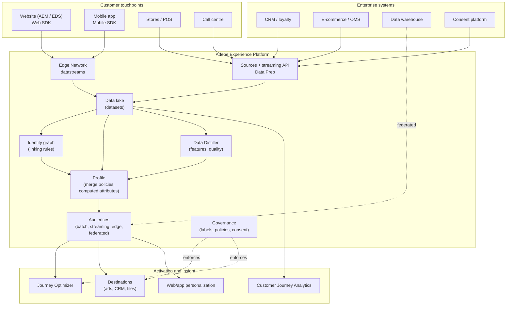
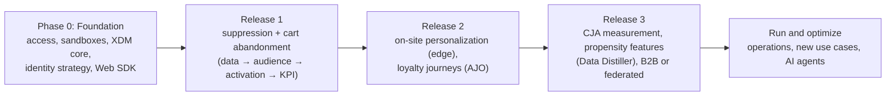

# Chapter 16: Architect playbook and AI

**Goal of this chapter:** you can lead an AEP solution design: run discovery, size the platform, choose patterns, write the design document, plan the roadmap, manage risks, explain AEP's AI capabilities, and answer architect-level interview questions.

---

## 1. The architect's job on an AEP program

1. Turn business goals into a **use-case catalogue** with value and priority.
2. Design the **data foundation** (sources, XDM, identity, profile) to serve those use cases.
3. Choose **latency, activation and governance patterns** per use case.
4. Check **licence and guardrails** against volumes.
5. Plan **delivery** (releases, environments, promotion, testing, operations).
6. Keep the **design documented** and decisions recorded.

## 2. Discovery: questions to ask

**Business**
- Top 5 use cases and their KPIs? Who owns each?
- Channels in scope (web, app, email, SMS, ads, call centre, stores)?
- Current pain points (data silos, slow campaigns, wasted media)?

**Data**
- Systems of record for customer, orders, products, consent? Volumes and update frequency?
- Stable person identifier across systems? Shared devices or shared emails?
- Existing warehouse/lakehouse (Snowflake, BigQuery, Databricks)? Should data be copied or federated?

**Technology**
- Current tags/analytics (AppMeasurement, at.js, GTM)? Website/app platforms (AEM, EDS, React, native apps)?
- Email/ad platforms and CRMs to connect?
- Security: data region, SSO, network restrictions, CMK, HIPAA/PCI concerns?

**Organization**
- Who will operate AEP after go-live? Data engineering capacity? Privacy/DPO involvement?
- Licence: edition, package, add-ons, profile and data volumes?

## 3. Reference architecture (B2C retail example)

Variations:
- **Financial services**: stricter governance (labels, ABAC, CMK), heavier batch from core systems, careful consent; often Healthcare/Privacy & Security Shield.
- **B2B**: Real-Time CDP B2B edition; accounts and opportunities from CRM; Marketo Engage; account audiences to LinkedIn.
- **Warehouse-centric**: Federated Audience Composition on Snowflake/BigQuery with AEP for real-time and activation.

## 4. Sizing and guardrail check (template)

| Item | Expected volume | Guardrail / licence | OK? | Mitigation |
| --- | --- | --- | --- | --- |
| Total profiles (addressable audience) | e.g. 12 M | Licensed volume | | Pseudonymous expiration |
| Web events per day | e.g. 40 M | Ingestion + Profile richness | | Event expiration 90 days; lake-only raw |
| Events per profile (segmentation) | max ~800 | 5,000 latest used | | — |
| Event size | ~3 KB | 10 KB hard | | Trim fields |
| Batch files per day into Profile | 30 | 90 per sandbox per day | | Combine files |
| Identities per graph | up to ~12 | Identity guardrails | | Linking rules |
| Streaming audiences | 60 | Segmentation guardrails | | Prioritize |
| AJO unitary events/sec at peak | 800 | 5,000 org-level shared | | — |

Fill it with the client's numbers and the current guardrail pages (links in Chapter 2).

## 5. Solution design document: outline

1. Context, goals, scope, assumptions, licence.
2. Use-case catalogue (with priority and KPI).
3. Architecture overview (diagram above, adapted).
4. Data sources and ingestion design (per source).
5. XDM model (schemas, field groups, relationships) + data dictionary link.
6. Identity strategy (namespaces, primary identities, linking rules, examples).
7. Profile design (Profile-enabled datasets, merge policies, computed attributes, expiration).
8. Audience design (inventory, evaluation types, naming).
9. Activation design (destinations, mappings, schedules; AJO journeys).
10. Analytics/measurement (CJA connections, KPIs, holdouts).
11. Governance, privacy and security (labels, policies, consent, Privacy Service, roles).
12. Environments and DevOps (sandboxes, promotion, monitoring, alerts).
13. Non-functional requirements and guardrail check.
14. Risks, decisions (ADRs), open questions, roadmap.

## 6. Roadmap pattern

Each release delivers end-to-end value and adds only the data it needs.

## 7. Typical risks and mitigations

| Risk | Mitigation |
| --- | --- |
| Identity over-merging | Linking rules, data quality filters, graph simulation, monitoring |
| Late data from source teams | Early data contracts, sample files in week 1 |
| Licence overage | Lean Profile, expiration policies, monthly licence review |
| Consent gaps | Consent model in phase 0; consent dataset precedence |
| Scope creep ("load everything") | Use-case-driven releases |
| Lack of operating team | Runbooks, training, hypercare, managed-service plan |

## 8. AI in AEP (what to know in 2026)

| Capability | What it does |
| --- | --- |
| **AI Assistant** | Conversational help inside Experience Platform apps: product knowledge ("how do I…"), operational insights about your objects (audiences, schemas, datasets), and the entry point for agents |
| **Experience Platform Agents** | Purpose-built agents working through AI Assistant, for example the **Audience Agent** (create, optimize and analyse audiences), the **Journey Agent** (create and analyse journeys in AJO), and the **Data Insights Agent** (questions over CJA data); availability depends on the licensed apps |
| **Agent Orchestrator** | The layer that coordinates agents for multi-step tasks; not sold as a separate product |
| **AI in apps** | Data validation insights in AI Assistant (2026), AI-driven audience creation in Federated Audience Composition, content generation and experimentation in AJO, lookalike audiences and AI models in Real-Time CDP (by package) |

Architect's view on AI:
- AI makes good foundations faster to use; it does not fix poor data models or identity.
- Govern AI like any user: roles, permissions, human approval for activation-impacting actions, audit.
- Document which AI features are enabled and who may use them.

Docs: [AI Assistant tutorial](https://experienceleague.adobe.com/en/docs/platform-learn/tutorials/ai-assistant/overview) · [Agentic AI in Adobe Experience Cloud](https://experienceleague.adobe.com/en/docs/core-services/interface/features/agentic-ai) · [Webinar: AI agents in AEP](https://experienceleague.adobe.com/en/docs/events/adobe-customer-success-webinar-recordings/2025/aep2025/ai-agents) · [Experience League Live: Agent Orchestrator](https://experienceleague.adobe.com/en/docs/events/experience-league-live-recordings/episodes/exl-live-episode-10-22-25) · [AI features in Journey Optimizer](https://experienceleague.adobe.com/en/docs/journey-optimizer/using/get-started/ai-features)

## 9. Architect interview questions with model answers

1. **Explain AEP to a CMO in 1 minute.** It unifies customer data from every channel into real-time profiles, builds audiences and activates them across ads, email, web and apps, with governance and consent built in; AJO and CJA turn that into journeys and measurement.
2. **Record vs time-series data?** Profile class (current attributes, overwritten) vs ExperienceEvent class (append-only, timestamped).
3. **How do you prevent profile collapse?** Stable person ID as unique, highest-priority namespace (linking rules), clean placeholders, don't use shared identifiers as links, test with graph simulation, monitor graph sizes.
4. **When batch vs streaming vs edge?** Driven by the use case's latency: daily vs minutes vs same page; edge needs simple, edge-eligible rules and the active-on-edge merge policy.
5. **Why not Profile-enable everything?** Licence (profile richness), performance (segmentation), noise; keep analytics data lake-only.
6. **Merge policy design?** Private graph stitching; timestamp ordered by default; dataset precedence where a source of truth exists (consent, CRM).
7. **How do you promote changes?** Build in dev, review in Git, sandbox tooling packages to prod, post-deployment checks.
8. **How is governance enforced?** Labels + policies + marketing actions evaluated at activation; consent filtering; ABAC.
9. **A destination receives far fewer people than the audience. Why?** Missing mapped identity, consent filtering, governance exclusions, partner match rate.
10. **Warehouse-first client?** Federated Audience Composition for audiences without copying; AEP for real-time events, identity and activation; dataset export back to the warehouse.
11. **Design abandoned-cart in AJO.** Web SDK cart and purchase events with identities, unitary event journey (or streaming audience), wait, purchase check, email then push, frequency rules, suppression, measurement.
12. **Biggest risks in AEP programs?** Identity, data readiness, scope, licence, operating model.
13. **CJA vs Adobe Analytics?** Any AEP dataset, person-level, retroactive data views; migration via Web SDK and the Analytics connector.
14. **How do you size AEP?** Profiles, events/day, events per profile, event size, batch frequency, audiences, peak event rates vs guardrails and licence.
15. **Where does AI help today?** Faster audience/journey creation and analysis through AI Assistant and agents, data validation, content generation and decisioning, all governed by roles and approvals.

## 10. Official docs and videos

- [How Platform and applications work together](https://experienceleague.adobe.com/en/docs/experience-platform/landing/getting-started/apps-overview)
- [Licence entitlement best practices](https://experienceleague.adobe.com/en/docs/experience-platform/landing/license/data-management-best-practices)
- [Profile guardrails](https://experienceleague.adobe.com/en/docs/experience-platform/profile/guardrails) · [Identity guardrails](https://experienceleague.adobe.com/en/docs/experience-platform/identity/guardrails) · [Ingestion guardrails](https://experienceleague.adobe.com/en/docs/experience-platform/ingestion/guardrails) · [AJO guardrails](https://experienceleague.adobe.com/en/docs/journey-optimizer/using/get-started/essentials/guardrails) · [CJA guardrails](https://experienceleague.adobe.com/en/docs/analytics-platform/using/technotes/guardrails)
- [Experience Platform release notes (monthly)](https://experienceleague.adobe.com/en/docs/experience-platform/release-notes/latest)
- [Adobe Blueprints (reference architectures)](https://experienceleague.adobe.com/en/docs/blueprints-learn/architecture/architecture-overview/platform-applications)

---

Previous: [Chapter 15](15-apis-automation-devops.md) · Back to [course index](../README.md)
