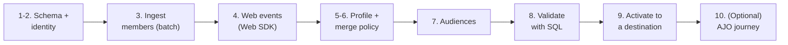

# Hands-on lab: from raw data to an activated audience

**Time:** 3-4 hours · **Where:** a **development sandbox** · **Prerequisites:** Chapters 0-10, the API set-up in [`code/api/README.md`](../code/api/README.md), AEP roles that allow managing schemas, datasets, audiences and destinations in the dev sandbox.

You will build a small "Acme loyalty" implementation end to end:



Throughout the lab, write down IDs (schema `$id`, dataset IDs, audience IDs) in a notes file.

---

## Step 0: Set up (15 min)

```bash
cd code/api
python3 -m venv .venv && source .venv/bin/activate
pip install -r requirements.txt
cp .env.example .env   # fill in client ID/secret, org ID, AEP_SANDBOX=<your dev sandbox>
python explore_sandbox.py
```

**Expected:** the script prints your tenant ID and the sandbox's schemas/datasets. If you get 403, ask the admin to give the credential a role for the dev sandbox.

## Step 1-2: Create the loyalty schema, identity and dataset (20 min)

```bash
python create_loyalty_schema.py --dry-run   # review the field group
python create_loyalty_schema.py
```

**Expected:** namespace `loyaltyId`, field group "Acme Loyalty Details", schema "Acme - Loyalty Members - CRM" enabled for Profile, dataset with the same name enabled for Profile and Identity. Verify in the UI: **Schemas** (Profile toggle on, `loyaltyId` primary) and **Datasets**.

## Step 3: Ingest loyalty members (20 min)

```bash
python batch_ingest.py --dataset <LOYALTY_DATASET_ID> --file ../../labs/data/loyalty-members.json
```

**Expected:** batch status `success`, 5 records written. In **Datasets → dataset**, see the batch; preview data.
If it fails: open the batch, download error diagnostics, compare field names/types with the schema.

## Step 4: Web events with the Web SDK (45 min)

1. **Schemas → Create** an ExperienceEvent schema "Acme - Web Events" with field groups *AEP Web SDK ExperienceEvent*, *Web Details*, *Commerce Details*; enable for Profile. Create the namespace `crmId` too (`python identity_tools.py create --name "CRM ID" --code crmId`) if you want to test login, and use `loyaltyId` in the demo instead of `crmId` to link to this lab's members (edit `commerce-events.js`: replace `crmId` with `loyaltyId` and log in with `L-100234`).
2. **Datasets → Create** "Acme - Web Events" from that schema; enable for Profile.
3. **Datastreams → New**: name `acme-web-dev`, schema "Acme - Web Events"; add the **Adobe Experience Platform** service with the event dataset.
4. Edit [`code/web-sdk/web-sdk-demo.html`](../code/web-sdk/web-sdk-demo.html): set `datastreamId` and `orgId`.
5. Serve the folder (`npx serve code/web-sdk`), open the page, click **Accept cookies**, **Log in**, **Add to cart**, **Buy now**.
6. Watch DevTools → Network (`interact`) and the Adobe Experience Platform Debugger.

**Expected:** within minutes, events appear on the profile of `L-100234` (step 5) and in the dataset (lake data can take longer).

## Step 5-6: Look at profiles and merge policies (20 min)

```bash
python profile_lookup.py --ns loyaltyId --id L-100234
python profile_lookup.py --ns loyaltyId --id L-100234 --events
python profile_lookup.py --merge-policies
```

In the UI: **Profiles → Browse** (namespace `loyaltyId`, value `L-100234`): attributes, events, identity graph (ECID linked after the demo login).

**Exercise:** create a second merge policy with **dataset precedence** listing only the loyalty dataset. Look up the same profile with each policy (`--merge-policy <ID>`). What changes?

## Step 7: Audiences (30 min)

```bash
python audiences.py create ../segmentation/gold-members-uk.json --tenant <YOUR_TENANT_ID>
python audiences.py create ../segmentation/high-value-points-streaming.json --tenant <YOUR_TENANT_ID>
python audiences.py list
python audiences.py evaluate <GOLD_UK_SEGMENT_ID>
python audiences.py job <JOB_ID>
```

Then in the UI, build one audience yourself in the **Segment Builder**: "Added to cart in the last 1 day and no purchase in the last 1 day". Check which evaluation method it gets.

**Expected:** "Gold members UK" = 1 profile (Asha). "Points above 4000" = 3 profiles (4200, 5100, 12500) and qualifies new members within minutes if you stream an update.

## Step 8: Validate with SQL (20 min)

In **Queries → Create query** (use your table names from the dataset pages):

```sql
SELECT _<tenant>.loyalty.tier AS tier, COUNT(*) FROM <loyalty_table> GROUP BY 1;

SELECT eventType, COUNT(*) FROM <web_events_table>
WHERE timestamp >= date_sub(current_date, 1) GROUP BY eventType;
```

**Expected:** 2 gold, 1 silver, 1 bronze, 1 platinum; the web event types you clicked.
Compare with the audience counts from step 7 and explain any difference.

## Step 9: Activate to a destination (30 min)

Use a destination your sandbox allows, e.g. **Amazon S3**, **Azure Blob** or **Data Landing Zone** (file-based), so no data goes to a real ad platform:

1. **Destinations → Catalog → (cloud storage) → Set up**; marketing action e.g. *Email targeting*.
2. **Activate** "Gold members UK"; export daily; map `loyaltyId`, `personalEmail.address`, `_<tenant>.loyalty.tier`.
3. Review (watch for governance messages), finish.
4. After the run, download the file and check its contents. List runs with `python destination_flows.py`.

**Exercise:** add the **C2** label to `personalEmail.address` and enable the core "3rd party export restriction" policy in the dev sandbox. Try activating to a destination with the *Export to third party* marketing action. What happens?

## Step 10 (optional): Journey Optimizer (45 min)

If AJO is licensed: configure a unitary event on `commerce.productListAdds` for the web schema, build a journey (event → wait 10 min → condition "no purchase" → email to a test profile), add your profile as a test profile, run **test mode**, and send [`code/journey-optimizer/unitary-event-cart-abandoned.json`](../code/journey-optimizer/unitary-event-cart-abandoned.json) with the right event ID.

## Step 11: Clean up

- Disable/delete the destination dataflow, audiences, test journey.
- Delete the lab batches (or reset the dev sandbox if allowed and agreed with the team).
- Keep the schemas if the team wants to reuse them; otherwise remove datasets, then schemas.

## Troubleshooting

| Problem | Check |
| --- | --- |
| 401/403 on API calls | Credential product profile and AEP role for the sandbox; correct `AEP_SANDBOX` |
| Batch failed | Error diagnostics; tenant placeholder replaced; field types |
| Profile not found | Dataset Profile-enabled before ingestion? Correct namespace code and value? |
| Web events missing | Datastream service and dataset; consent accepted; schema field groups |
| Audience empty | Evaluation job finished? Merge policy? Data in Profile? |
| Activation blocked | Governance violation message: labels vs marketing action |
